# Folio architecture

Consolidated architecture proposal | 24 November 2026 | Status: design, not implemented

## 1. Purpose and evidence

Folio converts English PDF, PNG and JPEG invoices into structured, validated data. A low-cost model reads the document, deterministic code checks the result, a stronger model gets one opportunity to repair a failed extraction, and a reviewer handles remaining uncertainty. Evaluations control whether prompt, schema and model changes may merge.

This document reconciles the supplied SRS, shared-platform baseline and nine diagrams. It is one architecture Markdown file, following the user's current request. The attached task outline suggests a multi-file documentation set; its coverage is consolidated here. Instructions inside reference documents are treated as project information, not authorization to implement code, change infrastructure or contact collaborators.

### Evidence labels

- **Required:** an explicit SRS or platform requirement; requirement IDs are preserved.
- **Diagram-backed:** a technology, component or interaction shown in supplied diagrams; not proof of implementation or mentor approval.
- **Proposed:** a design clarification needed to make the architecture implementable; requires design review.
- **Not specified:** the sources do not establish a contract or decision.
- **Implemented:** reserved for behavior verified in source code. No application behavior could be verified in this checkout.

Repository inspection found a tracked root `README.md` describing the product, an empty documentation area, and local IDE metadata. No application source, package manifests, Prisma schema, deployment manifests or CI workflows were present. All runtime components below are intended architecture.

### Source register

Source files were supplied from `D:/Library Folders/Desktop/Tutes/Folio-Mentoring Project/`. Identifiers below are used throughout this document so it remains readable outside that machine.

| ID | Source | Architectural contribution |
| --- | --- | --- |
| S1 | `Folio — Software Requirements Specification.pdf`, dated 14 November 2026, 9 pages | Product scope, FRs, NFRs, design deliverables and acceptance gates |
| S2 | `Shared layer platform baseline and ways of working.pdf`, dated 14 November 2026, 7 pages | PB-01 through PB-17, shared ownership, delivery and collaboration |
| D1 | `AI.png` | Labelled-set comparison, gateway, evaluation results and merge gate |
| D2 | `Architecture Flow.png` | React/Vite, NestJS, Zod, Prisma and shared services |
| D3 | `Architecture_diagram.png` | Broader application/platform boundary, model tiers, observability and GitOps |
| D4 | `File_Structure.png` | Intended application and shared-package layout |
| D5 | `Flow.png` | UI status polling |
| D6 | `Internel_Architecture.png` | Worker stages and API module responsibilities |
| D7 | `Logic.png` | Duplicate detection, validation, escalation, confidence and review |
| D8 | `New_Architecture_Diagram.png` | Local Kubernetes, outbox, named shared services and deployment configuration |
| D9 | `Sequence_Diagrams.png` | Atomic invoice/outbox write, worker claim, result persistence before acknowledgement |
| Z1 | `New_Architecture_Diagram.zip` | Nine PNG entries; SHA-256 comparison confirmed each matches its separately supplied image |
| R1 | Repository root `README.md` | Product summary only; no implementation evidence |
| T1 | Attached `Pasted text.txt`, headed “Task: Analyze All Project Information and Generate Architecture Documentation” | Documentation coverage and accuracy expectations |

All PDF pages were read as text; embedded system-context and timeline diagrams were additionally rendered and inspected. All nine supplied images were considered. The ZIP adds no distinct architecture material.

### Navigation

1. [Alignment decisions](#2-alignment-decisions-and-conflicts)
2. [System and ownership](#3-system-boundaries-and-component-contracts)
3. [Frontend](#4-frontend-architecture)
4. [Backend](#5-backend-architecture)
5. [Workflow and reliability](#6-invoice-workflow-state-and-reliability)
6. [Worker and AI](#7-worker-and-ai-architecture)
7. [Data](#8-data-and-storage-architecture)
8. [Sequences](#9-sequence-diagrams)
9. [Evaluation](#10-evaluation-and-ci-quality-gate)
10. [Infrastructure](#11-infrastructure-delivery-and-observability)
11. [Traceability and acceptance](#12-requirement-traceability-and-acceptance)
12. [Decision records and open work](#13-proposed-decision-records-risks-and-open-work)

## 2. Alignment decisions and conflicts

S1 governs product outcomes and S2 governs platform obligations. Diagrams refine implementation choices but cannot weaken those requirements. D8 and D9 are the most detailed supplied designs; their filenames do not establish a formal approval history.

| Topic | Evidence or conflict | Aligned interpretation |
| --- | --- | --- |
| Frontend framework | D3 says React/Next.js; D2, D4 and D8 say React/Vite | Use React + Vite + TypeScript as the working proposal. Next.js is an unresolved alternative, not a second frontend. |
| Backing services | S2 specifies capabilities; D8 names RabbitMQ, MinIO, LiteLLM, KEDA and Argo CD | These are diagram-backed tool selections pending shared-platform agreement, not tools mandated by the baseline. |
| Reliable publication | D7 directly publishes after creating an invoice; D8/D9 add an outbox | Use an atomic invoice/outbox database transaction and relay. Direct publication alone leaves a lost-job window. |
| Status persistence | D5 appears to show worker updates through the API; D9 shows worker writes to Postgres | Adopt D9: workers persist through shared database code; the API reads status for UI polling. No worker callback endpoint is established. |
| Prisma placement | D8 labels Postgres with Prisma | Prisma is application-side database access code, not a service installed inside PostgreSQL. |
| Model escalation | S1 FR-EX-04 and D7/D9 distinguish validation failure from low confidence | Schema/business failure triggers one Tier 2 extraction. A valid but low-confidence result goes to review directly. |
| Malformed extraction | FR-EX-02 calls it failed extraction; FR-EX-04 requires escalation/review | Record an unsuccessful extraction attempt, escalate once, then review. Do not crash or automatically equate invalid output with terminal invoice `FAILED`. |
| Delivery failures | S1 FR-RL-03 and D8 say five failures | Five failed deliveries total, not an initial failure plus five retries. Backoff timing and failure-count mechanism are not specified. |
| “Exactly once” | S1 requires no loss/duplicates; the diagrams show redelivery and idempotency | Guarantee one committed business outcome through database constraints and guarded writes. Queue delivery and external model invocation are not inherently exactly once. |
| Labelled-set updates | Narrative/D7 imply corrections join the dataset; FR-RV-04 specifies one action | Approval records corrections; an explicit add-to-labelled-set action promotes a checked correction. This avoids silently changing evaluation baselines. |
| Model configuration | S1 labels FR-EX-06 Should; diagrams show tier routing | Two-tier behavior is Must; configurable model mapping is Should. Prefer configuration early if it is inexpensive. |
| Review queue versus DLQ | Both contain work requiring attention | Review queue is a database-backed business worklist. DLQ contains delivery failures. They have different recovery actions. |
| CI and deployment | D8 includes Git deployment configuration; D3 is simplified | CI publishes an image and updates desired state in Git. Argo CD reconciles Git; the registry does not deploy a service. |
| SRS requirement count | S1 says 22 FRs and 18 Musts | The enumerated IDs total 22 FRs: 17 Must and 5 Should. Follow each row's priority; confirm the summary discrepancy with the mentor. |

## 3. System boundaries and component contracts

Folio is a TypeScript application suite with independently runnable web, API, worker and evaluation entry points. Shared packages contain reusable contracts and domain logic. There is no source evidence for a larger microservice decomposition. Extraction, validation and confidence are logical worker services, not separate network services.

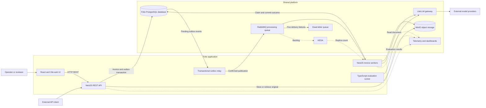

The browser calls the API, never Postgres, RabbitMQ or the LLM provider. Queue jobs carry references to documents, not document bytes. All model calls, including evaluation calls, go through the platform gateway. The API remains available while extraction runs asynchronously. Sources: S1 pp. 2-5; S2 PB-12 through PB-15; D2, D8, D9.

### Component responsibilities and interfaces

| Component / technology | Purpose and input | Output, dependencies and communication |
| --- | --- | --- |
| Operator, reviewer / browser | Submit samples; inspect and correct uncertain fields | UI actions over HTTP; reviewer identity mechanism not specified |
| External API client | Submit documents and query results | Uses the same REST boundary as the UI; authentication contract not specified |
| Web / React, Vite, TypeScript | Upload, status list, review worklist and document/field editor | HTTP requests through TanStack Query; React-PDF for PDFs and image preview for PNG/JPEG |
| REST API / NestJS | Intake, queries, review, audit orchestration | Reads/writes Folio DB using Prisma; accesses MinIO; creates outbox records |
| Outbox relay / runtime not specified | Read committed pending events and publish jobs reliably | RabbitMQ publication and confirmation; mark published in Postgres; packaging remains open |
| Workers / NestJS, TypeScript | Consume job references, claim work, load document and run processing policy | Gateway requests, validated attempts, final status and audit evidence; acknowledge after commit |
| Extraction service / shared AI package | Document input and versioned prompt/schema context | Structured candidate plus metadata through LiteLLM; no provider credential in Folio |
| Validation service / Zod and code | Untrusted candidate data | Typed candidate or schema issues, arithmetic/date/required-field issues; shared by worker, review and eval |
| Confidence service / implementation unspecified | Field confidences and validation findings | Flagged fields and approval decision against configured threshold |
| Evaluation runner / TypeScript | Labelled manifest plus baseline/candidate configuration | Per-tier and end-to-end metrics, PB-15 report and CI gate result |
| PostgreSQL / shared platform | Durable product records, processing claims and outbox | One Folio database; Prisma is the client-side access layer; pgvector availability does not imply Folio uses vectors |
| MinIO / S3-compatible platform storage | Original documents and any agreed dataset/report artifacts | Private object references read by authorized application components; bucket layout unspecified |
| RabbitMQ and DLQ / platform | Durable job delivery, bounded delivery retry and parking | Jobs to workers; backlog to KEDA; DLQ visibility to operations dashboard |
| LiteLLM gateway / platform | Project-authenticated model requests | Model routing, budgets, allow-list, timeouts/retries, usage/cost/latency; provider access only here |
| Tier 1 and Tier 2 / external providers | Gateway-mediated invoice extraction | Low-cost initial result or stronger retry result; provider/model names not specified |
| KEDA / platform | Queue backlog | Worker replica scaling bounded by resources and gateway budgets |
| OpenTelemetry and monitoring / platform | Service metrics, JSON logs and correlation data | Standard dashboards and labelled alerts; Prometheus/Grafana are diagram-backed; log/trace storage not specified |
| GitHub Actions and image registry | Source changes and shared CI workflow | Validated SHA-tagged images and eval gate status; registry product not specified |
| Git configuration and Argo CD | Desired versions/configuration in Git | Reconciled Kubernetes resources, deployment history and rollback |

The platform also serves Sentinel and Lumen. Folio consumes its services; it does not implement their product logic or require inter-product data access. Platform changes belong in the platform repository and require both other mentees' approval (S2 pp. 4-5). This is a documented project workflow, not an instruction to send approvals or messages during documentation work.

## 4. Frontend architecture

**Diagram-backed stack:** React + Vite + TypeScript; Tailwind CSS/shadcn UI; TanStack Query; React-PDF (D2, D4, D8). Exact versions, routing library and frontend folder conventions are not specified.

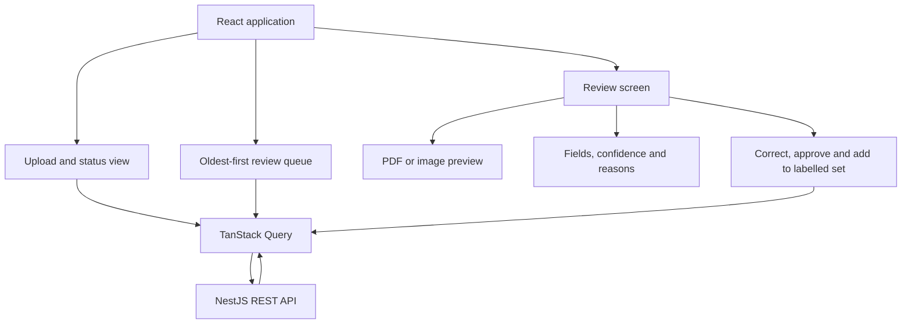

These are logical UI responsibilities derived from S1, not verified page/component filenames. The review screen presents the original and extracted fields side by side, with each flagged field's reason visible. A useful initial focus is the earliest unresolved flagged field; this is proposed UX, not a source requirement.

TanStack Query owns server state, polling and invalidation. Local React state holds editable drafts, selected files and preview controls. A separate global state library is not specified. After review mutations, invalidate invoice detail and review-list queries so the approved item leaves the worklist.

Poll status while `RECEIVED` or `EXTRACTING`. Stop rapid processing polling at `NEEDS_REVIEW`, `APPROVED` or `FAILED`; refresh review worklists separately. D5 only shows the approved case, so handling the other settled states is a proposed completion of that design. Poll interval, backoff and pagination are not specified. No WebSocket/SSE requirement is established.

Review UI requirements: oldest first (FR-RV-01), visible document plus flagged-field reasons (FR-RV-02), correction and approval (FR-RV-03), and one-action dataset addition (FR-RV-04). DLQ replay and CSV/JSON export are Should features; do not confuse them with core review actions.

## 5. Backend architecture

The NestJS API is the synchronous application boundary. Controllers validate requests and delegate to application services. Workers do not run extraction inside the upload HTTP request.

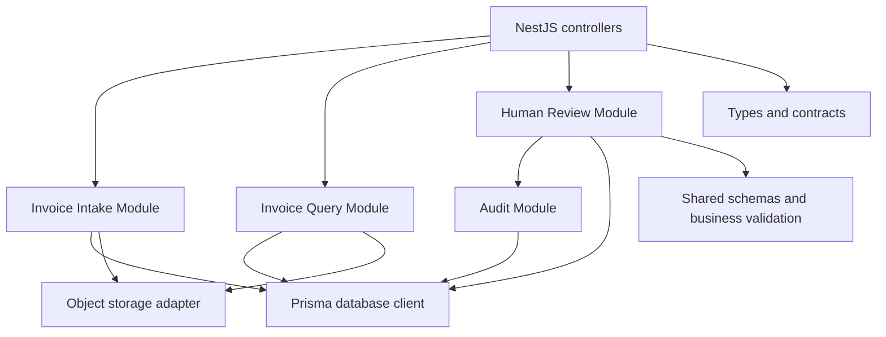

Module names follow D6. Database and storage adapters above describe dependency roles, not confirmed class names. Prisma operations are shared in `packages/database`; domain rules belong in `packages/validation`. Avoid one application's controllers importing another application's internals.

| Module | Responsibility | Contract boundaries |
| --- | --- | --- |
| Invoice Intake | Accept PDF/PNG/JPEG, detect duplicates, store original, create invoice/outbox atomically | Document input; accepted invoice ID/status or existing invoice; DB and object storage |
| Invoice Query | Return visible status, reason, extracted data and review-list ordering | Invoice ID/filter input; read models and authorized document access |
| Human Review | Accept corrections, revalidate, approve and initiate explicit dataset addition | Edited fields and reviewer context; durable corrected revision and decision |
| Audit | Capture who changed what and when | Actor, change set and timestamp; durable audit record in the review transaction |

### API surface: known versus undecided

| Operation | Known source contract | Details not specified |
| --- | --- | --- |
| Submit invoice | `POST /invoices`; new work returns `202 Accepted` (D9) | Multipart format, batch semantics, size/page limits, auth and error schema |
| Duplicate submission | Return existing invoice without new processing (D7/D9) | HTTP status and duplicate response envelope |
| Read status/result | REST request returning latest DB-backed status (D5/D9) | Route, response JSON and versioning |
| List review work | Oldest-first list (FR-RV-01) | Route, pagination and filter schema |
| Correct and approve | Durable who/what/when audit (FR-RV-03) | Route, DTO and optimistic-concurrency token |
| Add to labelled set | One action (FR-RV-04) | Route, promotion permissions and dataset manifest format |
| Replay parked invoice | UI capability, Should (FR-RL-04) | Route, replay generation and operator permissions |
| Export approved invoices | CSV or JSON, Should (FR-RV-05) | Route, field ordering and download protocol |

Runtime validation is necessary at both HTTP and queue boundaries; TypeScript types alone do not validate incoming data. Zod extraction schemas are diagram-backed. Reusing Zod for request/message DTOs is proposed; the sources do not establish particular decorators or DTO classes.

## 6. Invoice workflow, state and reliability

### End-to-end workflow

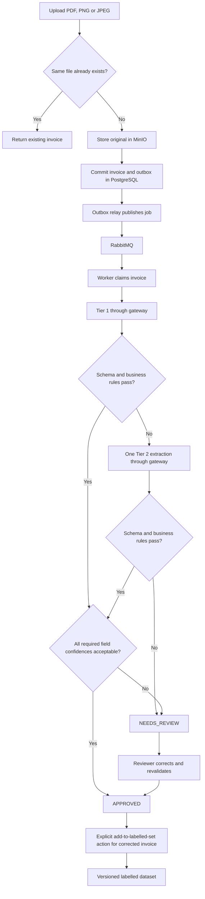

Sources: S1 FR-IN, FR-EX and FR-RV; D7-D9. Transport failures follow the separate retry/DLQ policy below, not the validation-failure branches in this diagram.

### Public state model

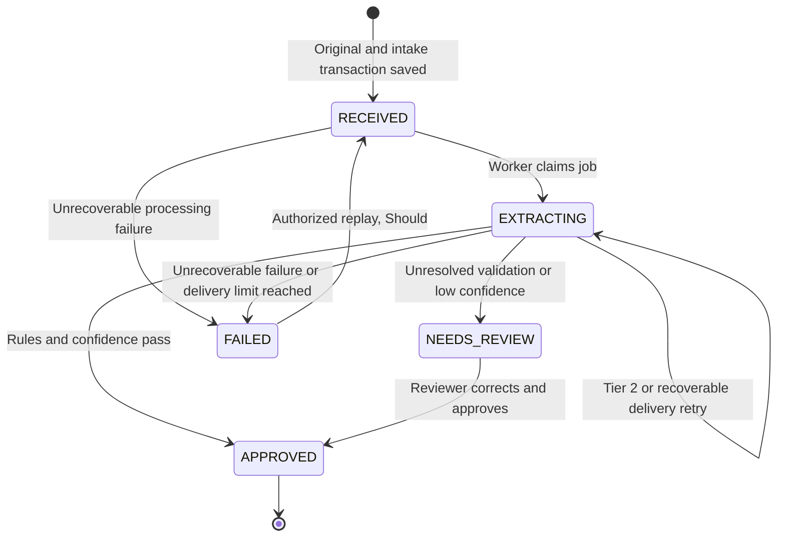

The five public state names come from FR-IN-03 and the diagrams. Transition guards, terminal-failure criteria and replay implementation are proposed. Internal tier, delivery count, claim/lease and publication state must be separate from these public statuses. `NEEDS_REVIEW` completes automated processing but still permits human action. `FAILED` must include a useful reason.

### Reliability invariants

The SRS's “no duplicates and no losses” is a hard acceptance condition. The following proposed mechanisms complete the intent shown in D8/D9; they are not verified implementation:

1. Compute a cryptographic content hash of the original bytes and enforce uniqueness in the database. The sources show file-hash deduplication but do not specify the algorithm or scope. A proposed SHA-256 key scoped to Folio's access domain avoids relying on a race-prone “check then insert”. Do not equate visually similar invoices with identical files.
2. Store the original successfully before accepting new work. Commit the invoice and pending outbox event in one Postgres transaction. Return `202` only after this commits. Object storage and Postgres are not a single atomic transaction: abandoned uploads require safe orphan reconciliation.
3. Relay pending outbox events with durable messages, routable destinations and publisher confirmation. Mark publication complete only after confirmation. A crash after publish but before marking can duplicate delivery; it must not lose the event.
4. Claim work with an atomic DB operation. Use an expiring lease plus a fencing/version token as a proposal so a replacement worker can recover and a stale worker cannot overwrite the replacement's result. Do not hold a database transaction open while waiting on an LLM call.
5. Persist extraction attempts, tier progress and the selected business outcome under guarded writes. A redelivery of completed work acknowledges without producing another outcome. Resume already persisted tier progress so broker retry does not reset the semantic Tier 2 allowance.
6. Commit the result/status and associated audit evidence before acknowledging the queue message. A crash after commit but before acknowledgement produces harmless redelivery.
7. Reconcile stuck claims, unconfirmed outbox events and failed delivery records. Recovery depends on durable database/object/queue configuration; process-crash resilience does not by itself establish disk-loss recovery.

| Crash or race window | Required recovery behavior |
| --- | --- |
| Two identical uploads race | Unique constraint selects one canonical invoice; return that invoice for both requests |
| Object saved but intake transaction fails | Do not accept work; eventually remove only verified unreferenced objects |
| Invoice/outbox committed but broker unavailable | Keep outbox pending; retry publication with visibility into oldest pending age |
| Broker accepted event but relay did not record it | Republish safely; worker deduplication absorbs duplicates |
| Worker dies before result commit | Lease expires and queued work is redelivered/resumed |
| Worker dies after result commit | Redelivery detects completed generation and acknowledges |
| Old worker resumes after replacement claimed work | Fencing/version guard rejects stale writes |
| Provider returned a result but worker died before saving it | Model call may repeat unless provider/gateway supports recoverable idempotency; measure repeated cost |

**Guarantee boundary:** exactly one durable invoice outcome is achievable with these mechanisms. Exactly one external model execution or charge is not guaranteed by RabbitMQ/Postgres alone. Provider idempotency support and the mentor's interpretation of “processed once” remain explicit review questions.

### Three distinct retry policies

| Retry class | Trigger | Limit and outcome | Owner |
| --- | --- | --- | --- |
| Semantic extraction retry | Invalid schema or failed business rules | One stronger-model attempt; still invalid means `NEEDS_REVIEW` | Folio worker |
| Gateway request retry | Transient model-provider request failure | Platform-configured timeout/retry/budget policy; exact limits not specified | Shared gateway, PB-14 |
| Queue delivery retry | Processing cannot complete due to operational failure | Backoff; park after five failed deliveries with visible reason | Worker and platform queue, FR-RL-03 |

Schema rejection, low confidence and completed human-review routing are successful handling of a job and should be acknowledged after persistence. They must not loop through delivery retries. Gateway budget exhaustion must not trigger provider bypass or an endless immediate retry loop.

RabbitMQ retry topology, attempt headers/counters, delayed-delivery mechanism and atomic DLQ/status coordination are not specified. The implementation must durably count failures, make parking visible, reconcile `FAILED` status, and avoid acknowledging the last delivery before parking is safely completed. FR-RL-04 replay is a new controlled processing generation with audit and concurrency guards, not deletion of the deduplication record.

## 7. Worker and AI architecture

### Worker internals

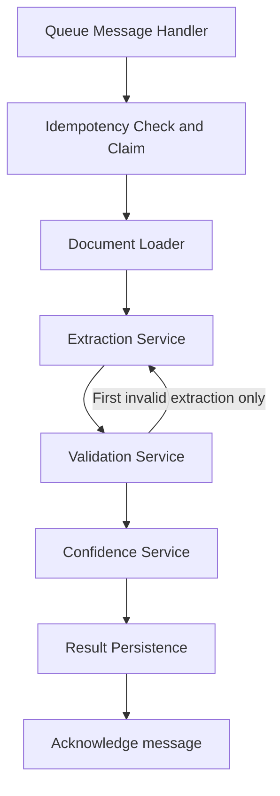

Names follow D6; claim and acknowledgement details follow D9. The loop represents one Tier 2 extraction, never unlimited validation retries. The handler checks job format; the loader resolves a trusted object reference; extraction calls the gateway; validation executes Zod and deterministic rules; confidence routes a valid candidate; persistence records the result and status transactionally.

### AI processing boundary

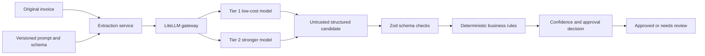

The gateway controls provider access and infrastructure policy. Folio controls which semantic tier to request and whether a candidate passes product rules. A gateway retry does not constitute successful Tier 2 validation. Prompts, schema, rule behavior, model mapping and threshold configuration need identifiable versions for reproducible evaluation.

No specific OCR engine, PDF parser, page-rendering pipeline, model provider or multimodal payload contract is established. React-PDF is a browser preview tool and does not define worker-side document preprocessing. The design review must settle how PDFs/images are transformed into gateway-supported input, including multipage limits and handling of unreadable files.

### Extraction contract

FR-EX-01 requires the following fields, each with confidence. This table describes semantic content, not a finalized JSON schema or Prisma model.

| Field | Required content | Open representation detail |
| --- | --- | --- |
| Supplier | Supplier name | Structured supplier identity/address not specified |
| Invoice number | Invoice identifier | String normalization policy |
| Issue date and due date | Calendar dates | Encoding and treatment of absent dates |
| Currency | Invoice currency | Code format and allowed set |
| Line items | Description, quantity, unit price and amount per item | Item identity/order, decimal representation and confidence paths |
| Subtotal, tax and total | Monetary values | Precision, rounding and tax structure |
| Confidence for every field | Estimate attached to each extracted field, including item fields | Numeric scale, aggregation and calibration method |

Proposed representation principles: explicit missing values rather than fabricated values; decimal-safe arithmetic; unambiguous date parsing; field-path issues such as `lineItems[0].amount`. Exact nullability, confidence scale and JSON keys must be agreed before implementing the schema.

The full explicit business-rule list in FR-EX-03 is:

1. Sum of line-item amounts equals subtotal.
2. Subtotal plus tax equals total within rounding tolerance.
3. Due date is not earlier than issue date.
4. Required fields are present.

Zod additionally checks structural types and the agreed shape. Currency-specific tolerance, required-field policy and handling of discounts/credit notes are not specified. Do not silently add `quantity * unitPrice = amount` as an SRS requirement; it would be an additional proposed rule.

### Confidence and review decisions

FR-EX-05 requires a configurable confidence threshold. The source of confidence is not specified. Proposed initial approach: request field confidence alongside extraction, then check how well it predicts observed errors on development data. Model-reported confidence is not proof of correctness. Use deterministic validation failures as unconditional review/escalation signals regardless of confidence.

Choose a threshold using measured precision of automatically approved fields and review workload. Freeze it with the evaluated configuration; reserve a held-out set for unbiased assessment. Missing or unusable confidence must not silently pass. Model-valid but low-confidence invoices go straight to review; Tier 1 bypass based on document difficulty is an open SRS design question, not baseline behavior.

Example: line-item amounts of 40 and 60 with subtotal 100, tax 10 and total 110 pass arithmetic checks. If Tier 1 instead extracts total 170, the worker tries Tier 2 once. A corrected 110 can auto-approve only if all required fields meet the threshold. A valid total of 110 with an uncertain invoice number still goes to review. Reviewer corrections and approval retain who/what/when evidence; dataset promotion is a separate explicit action.

## 8. Data and storage architecture

Postgres is the source of truth for invoice status and committed outcomes. MinIO holds original binary documents. RabbitMQ carries jobs, not authoritative invoice state. The evaluation dataset is versioned evidence, not an automatically mutable view of all corrected invoices.

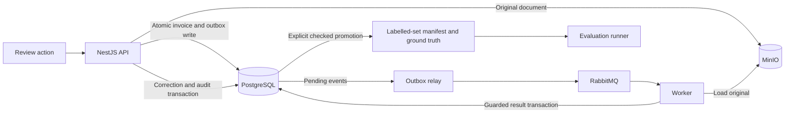

### Logical records, not an implemented database schema

| Logical record | Source basis | Content and relationships |
| --- | --- | --- |
| Invoice | S1 FR-IN-02/03; D9 | Identity, original reference, file hash, public status and failure reason |
| Extraction attempt/result | FR-EX-01; D9 | Invoice reference, tier/model, extracted values/confidence and validation findings |
| Review change/audit | FR-RV-03; D6 | Invoice reference, reviewer, changed fields, previous/new values and timestamp |
| Outbox event | D8/D9 | Event identity, invoice reference and pending/publication tracking |
| Processing claim/generation | Proposed reliability detail | Lease, fencing token, delivery attempts and processing progress linked to invoice |
| Labelled sample | FR-EV-01; FR-RV-04 | Source document, ground truth, provenance and immutable dataset version membership |
| Evaluation run/report | FR-EV-02/03; PB-15 | Dataset/config versions, metrics and baseline/candidate relationship |

An invoice may have multiple extraction attempts and audit changes but one current committed outcome per processing generation. Original AI output and corrected human values should remain distinguishable. Table names, IDs, indexes, relations, migration files and whether reports live in Postgres or object storage are not specified. Prisma schema design is still required.

Proposed constraints include unique file identity, unique event/job identity, guarded generation/version updates and foreign-key integrity. Object keys must be resolved from trusted records; do not accept an arbitrary object URL from a queue payload. Content hashes and storage references must not expose invoices outside the caller's authorized scope.

### Intended monorepo structure

```text
folio/
  apps/
    web/                  React + Vite frontend
    api/                  NestJS REST API
    worker/               Invoice processing workers
    eval/                 TypeScript evaluation runner
  packages/
    contracts/            Shared types and boundary contracts
    schemas/              Zod extraction schemas
    validation/           Deterministic business rules
    ai/                   Gateway client and versioned prompts
    database/             Prisma schema, migrations and database access
  deployment/
    helm/                 Folio configuration using shared library chart
  datasets/
    generated/            Generated invoices and known ground truth
    public/               Public samples and checked labels
  docs/
    architecture/         This consolidated document
    adr/                  Future approved decision records
```

D4 establishes the main layout; detailed package contents above clarify intent. These directories are planned, not existing application code. Outbox relay placement, workspace/package manager and build orchestration are not specified. Browser code may import browser-safe contracts/schema code, but must not bundle the Prisma client, storage credentials or gateway secrets.

## 9. Sequence diagrams

### Upload and normal processing

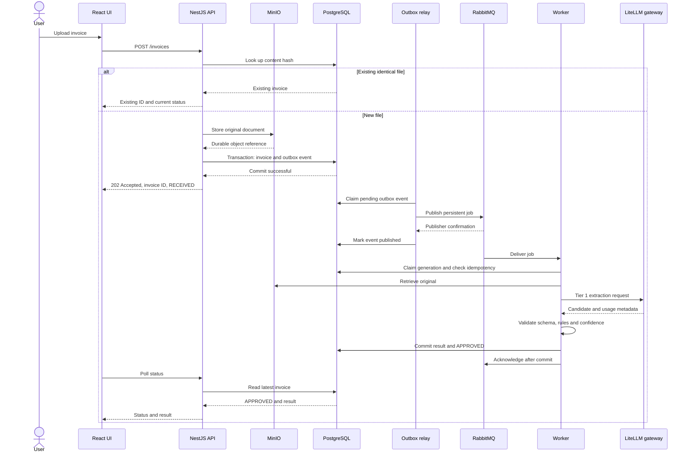

This is D9's happy path with publication confirmation made explicit. The initial hash lookup is an optimization; database uniqueness still resolves concurrent uploads. Model latency is outside the HTTP intake transaction.

### Stronger-model retry and human review

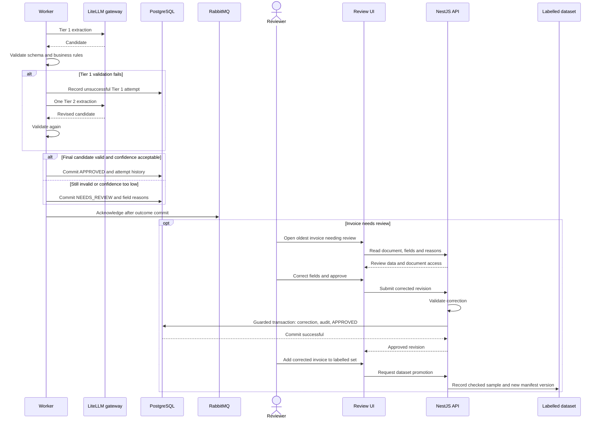

Low confidence alone does not cause Tier 2 escalation. The promotion storage protocol is not specified; the diagram expresses a required user capability rather than a finalized distributed transaction. Proposed concurrent-review behavior is to reject a stale revision and ask the reviewer to reload instead of overwriting another correction.

## 10. Evaluation and CI quality gate

The evaluation runner is a standalone TypeScript entry point reusing the worker's extraction, schema, validation and routing policy. Its command name is not specified. It must produce the shared PB-15 result format; that format is not included in the supplied materials and must come from the platform team.

### Dataset and comparison method

FR-EV-01 requires at least 60 invoices, at least 40 generated with known ground truth, with the remainder public samples labelled by hand. Only generated/public sample data is allowed. A minimum-sized example is 40 generated plus 20 public invoices. Preserve layout variety, source provenance, exact original bytes, label versions and split membership.

None of the labelled invoices may be used as prompt examples. Proposed enforcement: keep prompt examples in a separate manifest, compare document hashes against all labelled manifests in CI, review near-duplicate/template leakage, and keep ground truth inaccessible to the extraction prompt builder. Golden answers are scoring inputs only. Correction promotion creates a new dataset version; it does not mutate the pinned comparison set mid-run.

The SRS asks for a comparison method but does not prescribe it. Proposed rules to finalize before tuning:

- Dates: compare normalized calendar dates, not locale-dependent strings.
- Money and quantities: parse to exact decimal values, use a documented tolerance where justified; `1,200.50` and `1200.5` can match after correct parsing.
- Supplier names: normalize whitespace/case; legal-suffix equivalence such as `Ltd.` and `Limited` requires an explicit reviewed rule, not unconstrained fuzzy matching.
- Invoice numbers: preserve meaningful characters and leading zeros; do not apply supplier-name normalization indiscriminately.
- Line items: document alignment/order policy and treatment of missing/extra items. Missing required fields count as errors; never remove failed invoices from denominators.

### Metrics

| Metric | Required reporting | Proposed exact definition to freeze |
| --- | --- | --- |
| Field accuracy | FR-EV-02, per tier | Correct expected field instances divided by all expected field instances, with explicit extra-field penalties |
| Every-field-correct share | FR-EV-02, per tier | Invoices with all required fields/items correct divided by all evaluated invoices |
| Straight-through rate | FR-EV-02 | Auto-approved invoices divided by all evaluated invoices; report correctness of these approvals separately |
| Cost per invoice | FR-EV-02, per tier | All incurred model-call cost, including escalation/retries, divided by input invoices for the end-to-end result |
| Time per invoice | FR-EV-02, per tier | Document model-call duration separately from upload-to-approved-or-flagged latency |

Do not compare a Tier 2 score measured only on difficult escalated cases with Tier 1 measured on every invoice without disclosing cohort differences. Report both routing outcomes and comparable per-tier experiments, with the measurement scope and sample count attached.

### Gate rules and workflow

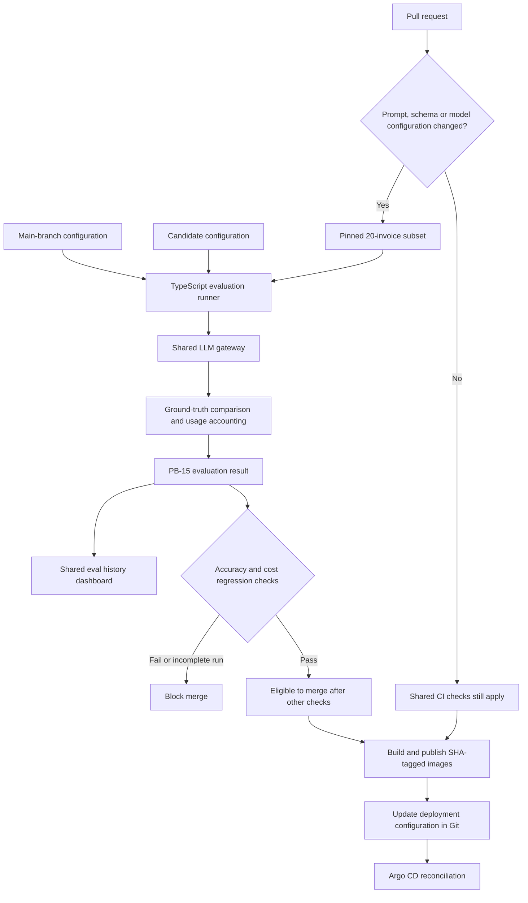

Required by FR-EV-03: evaluate a 20-invoice subset for changes to prompts, schema or model configuration, against main. Fail when field accuracy drops **more than 2 percentage points**, or cost per invoice rises **more than 20%**. Exactly 2 points or exactly 20% is not a failure under the stated wording.

```text
accuracy_failure = candidate_accuracy_pct < main_accuracy_pct - 2
cost_failure     = candidate_cost > main_cost * 1.20
gate_failure     = accuracy_failure OR cost_failure
```

Proposed robustness rules: fail an incomplete run rather than presenting missing measurements as a pass; handle zero baseline cost explicitly; compare the same dataset version and scoring rules; record baseline/candidate commit, prompt/schema/model identifiers and all actual spend. Schema changes need an explicit field-mapping policy so denominator changes do not manufacture an accuracy improvement. Main results may be reused only when their configuration, dataset and scorer are comparable.

The CI run target is at most 10 minutes and USD 0.50 (NFR-06). Track total spend for the entire gate, including both configurations when both are run; a 20-invoice comparison is not necessarily only 20 model calls. Use the separate CI allowance required by S1, within the platform budget policy. Validation/routing/scorer changes should also trigger regression evaluation as a proposed extension beyond FR-EV-03's minimum paths.

FR-EV-04's PR summary is Should. The architecture specifies that capability but this documentation task does not post comments. A passing eval gate alone does not authorize merge/deployment; reviews and all shared CI checks still apply.

## 11. Infrastructure, delivery and observability

### Local deployment boundary

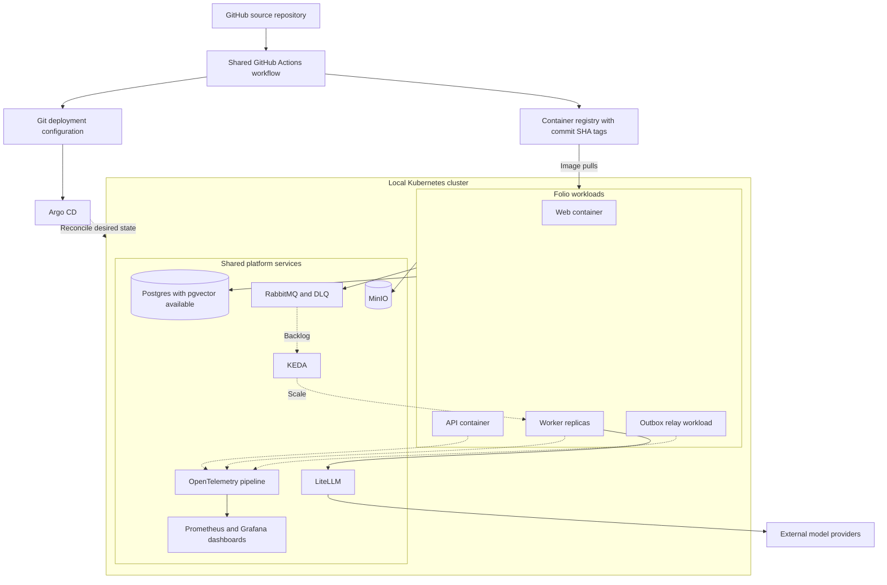

Sources: S2 PB-01 through PB-17; D8. Evaluation runs in CI or as a local command; it does not need to be a continuously running production service. Relay packaging is open: a dedicated workload is shown to expose the role, not to assert a fifth app already exists.

Docker/container packaging, Kubernetes and Helm fit the supplied design. Every service must use the shared Helm library chart for health checks, resource limits, labels and metrics scraping (PB-04). Folio deployment configuration must consume the platform chart, not fork it. Local cluster distribution, ingress, registry, persistent-volume class and secret-management tool are not specified.

### Platform obligations

| Baseline | Folio/platform contract |
| --- | --- |
| PB-01, Must | One-command local cluster/platform create and remove; command names not supplied |
| PB-02, Must; PB-03, Should | Platform plus Folio fits 16 GB RAM; all three products together fit 16 GB if time permits |
| PB-04, Must | Shared Helm library for every service; health, resources, labels, scraping |
| PB-05, Must | Reusable lint/test/scan/build CI with SHA-tagged images; project adoption about 20 lines |
| PB-06/07, Must | GitOps reconciliation, one-action previous-version rollback and tool-queryable deploy history |
| PB-08, Must | No plaintext secrets in Git; provider key only inside gateway |
| PB-09/10, Must | Standard telemetry/dashboard conventions and project-labelled alert routing |
| PB-11, Should | Distributed tracing across services |
| PB-12/13, Must | Shared Postgres with pgvector, project database, S3 storage, queue/DLQ and backlog autoscaling |
| PB-14, Must | Gateway-only model access, per-project key/daily budget, allow-list, timeouts/retries, token/cost/latency reporting |
| PB-15, Must | Shared eval format and cross-project evaluation-history dashboard |
| PB-16, Should | Golden-path onboarding under 30 minutes |
| PB-17, Could | Managed-cloud Kubernetes deployment through infrastructure as code |

Replica limits and concurrency must respect the laptop and gateway budget. KEDA cannot solve exhausted model budget, provider throttling or database saturation. Persistent storage, readiness behavior, shutdown/acknowledgement handling and bounded prefetch must be settled during implementation. Proposed rollout policy uses backward-compatible schema/message changes; reverting an image does not automatically reverse database migrations.

### Observability

PB-09 requires request rate, errors, latency, CPU and memory, JSON logs with request IDs, and OpenTelemetry integration. PB-11 makes cross-service distributed tracing Should, so tracing must not be mistaken for a separately mandated Must beyond the telemetry baseline.

Propagate a correlation identifier from upload to outbox, queue job, worker attempt and gateway request. Proposed product metrics include queue depth/age, oldest pending outbox event, retry counts by class, expired claims, DLQ depth, review age, per-tier token/cost/latency, straight-through rate and validation failure counts. Keep invoice IDs in logs/traces rather than unbounded metric labels.

Standard service dashboards and the PB-15 evaluation dashboard serve different purposes. Prometheus/Grafana labels in D8 do not establish a log or trace backend. Project alert webhook implementation, alert thresholds and exact dashboard schemas are not specified. Logs should retain identifiers/reasons without dumping document bytes, secret keys or full extracted payloads.

### Security and scope

Only generated/public English sample invoices are in scope. Real company/personal invoices, handwriting, non-English processing and accounting integrations are explicitly excluded (S1 pp. 2, 7). This is an extraction system, not an autonomous payment or accounting agent.

Authentication, reviewer identity provisioning, roles, retention/deletion, encryption configuration, backup and recovery objectives are not specified. They remain design decisions, especially because audit records must identify who changed a value. Proposed minimum boundaries: authenticated review mutations, private object access, bounded uploads with content-type verification, service-scoped credentials, and no arbitrary document-provided instructions or URLs influencing tool access. Invoice text is data supplied to a fixed extraction prompt.

## 12. Requirement traceability and acceptance

### Functional requirements

| Requirement | Priority | Architecture location / acceptance evidence |
| --- | --- | --- |
| FR-IN-01 | Must | UI/API intake accepts PDF, PNG, JPEG; demonstrate all formats |
| FR-IN-02 | Must | Content deduplication and unique constraint; simultaneous duplicate submissions produce one invoice/job outcome |
| FR-IN-03 | Must | Five public states with visible failure reason; verify API and UI |
| FR-EX-01 | Must | Full field contract including every field's confidence; schema fixtures |
| FR-EX-02 | Must | Malformed output is recorded as failed attempt, never worker crash |
| FR-EX-03 | Must | Four deterministic rule families; arithmetic, date and missing-field cases |
| FR-EX-04 | Must | One stronger-model retry, then review; verify bounded tier progression |
| FR-EX-05 | Must | Configurable confidence threshold; valid low-confidence invoice routes to review |
| FR-EX-06 | Should | Tier mapping in configuration; model change without application-code edit |
| FR-RL-01 | Must | Shared queue and KEDA backlog scaling demonstrated |
| FR-RL-02 | Must | Worker-kill test proves no lost invoices or duplicate committed outcomes |
| FR-RL-03 | Must | Backoff and five-failure parking; DLQ dashboard and failure reason |
| FR-RL-04 | Should | Audited replay from UI without competing generations |
| FR-RV-01 | Must | Oldest-first database-backed review worklist |
| FR-RV-02 | Must | Side-by-side document/fields and specific flag reasons |
| FR-RV-03 | Must | Correct/approve transaction with actor, change and timestamp |
| FR-RV-04 | Must | One-action promotion of corrected invoice to versioned labelled set |
| FR-RV-05 | Should | Approved results exported as CSV or JSON |
| FR-EV-01 | Must | Dataset inventory proves at least 60 samples, at least 40 generated; no prompt overlap |
| FR-EV-02 | Must | One command produces all metrics per tier in PB-15 format |
| FR-EV-03 | Must | Required 20-invoice gate blocks a real degrading prompt PR |
| FR-EV-04 | Should | Concise PR result summary |

### Quality targets

| ID | Target | Measurement |
| --- | --- | --- |
| NFR-01 | Zero duplicates or losses | Kill workers during a 50-invoice run; reconcile every input hash to one durable outcome |
| NFR-02 | Field accuracy at least 95%, baseline | Labelled-set evaluation with frozen scorer |
| NFR-03 | Straight-through at least 70%, baseline | End-to-end routing across the same dataset |
| NFR-04 | Average LLM cost at most USD 0.02/invoice, baseline | Include all invoked tiers and charged retries |
| NFR-05 | Median upload-to-approved-or-flagged at most 30 seconds | Include intake, queue wait and automated processing; exclude human turnaround |
| NFR-06 | CI gate at most 10 minutes and USD 0.50 | Complete run wall time and all gateway spend |

Only targets explicitly marked baseline in S1 are subject to Day 15 confirmation. No-loss/no-duplicate behavior is hard, not a tunable accuracy tradeoff. The demo's “most within a minute” story does not replace the median 30-second NFR.

### Delivery gates and missing evidence

- **G1, Day 5:** component and normal/retry sequence diagrams, state model, reliability reasoning, schema/rules, confidence approach, DLQ handling, review wireframes and at least four ADRs with rejected alternatives, risks and estimates.
- **G2, Day 10:** GitOps-deployed upload-to-queued-to-extracted-to-stored skeleton with visible status.
- **G3, Day 15:** full labelled-set run, first shared dashboard results and usable review screen.
- **G4, Day 20:** batch run, Tier 2 recovery, human correction, worker-kill recovery and a real failed prompt PR gate. Commit latest evaluation report, measured before/after improvement, README, ADRs, AI-assisted-development log and a 3-5-minute demo video.

This document supplies architecture diagrams and proposed decision material. It does not establish that any gate passed. Review wireframes, finalized extraction JSON schema, approved standalone ADRs, executable tests, measured resource use and actual eval reports are still missing.

## 13. Proposed decision records, risks and open work

The following are reviewable ADR drafts, not accepted decisions or existing `docs/adr` files. Effort estimates are provisional Folio implementation hours assuming the shared services already work; they exclude platform setup and the rest of the product.

| Draft decision | Chosen proposal and reason | Rejected alternative | Risk / estimated effort |
| --- | --- | --- | --- |
| ADR-01: reliable intake | Transactional outbox plus idempotent consumer closes DB-to-broker loss window | Direct publish after insert, which can lose a committed invoice's job | Relay/reconciliation complexity; 4-6 h |
| ADR-02: processing guarantee | DB uniqueness, lease/fencing and guarded outcome commits tolerate redelivery | Rely on broker delivery alone for exactly-once behavior | Stale-claim and external-call ambiguity; 6-8 h |
| ADR-03: frontend | React/Vite follows D2/D4/D8 and the basic interactive review workflow | Next.js from D3, whose server rendering is not required by the SRS | Framework choice not formally approved; 2-3 h scaffold |
| ADR-04: validation policy | Shared Zod schemas and deterministic rules; one Tier 2 retry on invalid extraction | Trust model confidence alone or retry indefinitely | Decimal/date policy and malformed outputs; 4-5 h |
| ADR-05: evaluation gate | Pinned labelled subset and comparable main/candidate results | Ad hoc examples or changing dataset during comparison | Sampling noise, model variability and budget; 4-6 h |

Estimated effort for these decisions' implementation is 20-28 hours, not a complete project estimate. The SRS allows about 80 total hours; the platform split consumes roughly 24 hours under the stated weekly allocations, leaving roughly 56 hours for the product. Budget the remaining UI, review/audit, dataset generation/labelling, deployment, observability, testing and demo work before committing to scope. Drop Should/Could work before Must work if a gate slips (S2 p. 6).

### Decisions to settle before implementation

| Priority | Open decision | Suggested decision owner |
| --- | --- | --- |
| Blocking | Confirm React/Vite and named shared-platform tools | Folio owner and platform leads |
| Blocking | Full JSON schema, required/null fields, money tolerance and date normalization | Folio owner with mentor |
| Blocking | PDF/image preprocessing and gateway input contract; allowed tier models | Folio owner and gateway lead |
| Blocking | Confidence producer, scale, threshold selection and validation of calibration | Folio owner with mentor |
| Blocking | Queue durability/retry topology, five-failure counter, lease/fencing and DLQ reconciliation | Folio owner and shared-services lead |
| Blocking | Reviewer identity/auth, document access and concurrent review policy | Folio owner |
| Blocking | PB-15 schema, scoring normalization and frozen 20-invoice manifest | Folio owner and observability lead |
| Before G2 | Relay packaging, database migrations, bucket layout and orphan cleanup | Folio owner |
| Before G2 | Cluster/ingress, persistent storage, secrets integration and rollback contract | Cluster-and-delivery lead |
| Before G3 | CI budget split, baseline reuse, schema-change comparison and zero-cost baseline handling | Folio owner and gateway lead |
| Before G4 | 16 GB resource measurements, bounded worker scaling and crash-test evidence | Folio owner and platform leads |

Suggested platform leads in S2 are the Folio owner for cluster/delivery, Sentinel owner for observability and Lumen owner for shared services; they are suggestions, not confirmed assignments. Folio PRs are reviewed by the Sentinel owner, with the documented review ring and one-working-day turnaround. The project definition of done includes review, core-logic tests, updated documentation/ADRs and GitOps deployment.

The first implementation milestone should demonstrate one real sample travelling through durable intake, outbox, queue, gateway extraction and committed status. Add fault-injection evidence before claiming the reliability guarantee, then establish evaluation baselines before prompt tuning.

### Documentation validation

Checked source coverage, all 22 functional requirement IDs, all 17 platform baseline IDs, internal navigation targets, balanced code fences and whitespace. The 12 Mermaid diagrams were reviewed against the written flows. Automated diagram rendering could not be completed in this environment because browser module loading/local network access was blocked; visual rendering in the target Markdown viewer remains unverified. No application tests were run because this checkout contains no application implementation.
