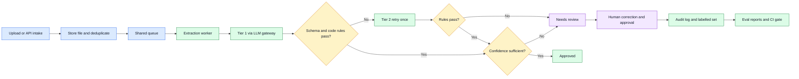

# Folio — Implementation Tickets and Step-by-Step Startup Guide

**Project:** Folio — invoice extraction, deterministic validation, human review and eval-gated delivery  
**Planning horizon:** 20 working days / four weeks (~80 hours for one product owner, including shared-platform duties)  
**Document status:** Actionable initial backlog; technical choices require Day 5 design approval  
**Suggested location:** `docs/Folio_Tickets_and_Startup_Guide.md` in the Folio repository  
**Ticket convention:** `FOL-001` onward for product work; `PLAT-001` onward for shared-platform work  
**Last prepared:** 2026-11-25

> **Sources:** *Folio — Software Requirements Specification* (November 14, 2026), *Shared layer: platform baseline and ways of working* (November 14, 2026), and the nine diagrams in `New_Architecture_Diagram.zip`. Requirements and gate dates come from the PDFs. Code structure and technology selections below come from the architecture diagrams and are **proposals**, not mandated choices or proof of an existing implementation.

---

## 1. What you are building

Folio accepts PDF, PNG and JPEG invoices, extracts a fixed set of fields through the **shared LLM gateway**, validates the data using **code rather than the model**, and either approves it, retries once with a stronger model, or sends it to a reviewer. Human corrections become labelled evaluation examples. A CI evaluation gate blocks harmful prompt/schema/model changes.

### Required user-visible workflow



**Important distinctions**

- The SRS requires **22 product functional requirements**: 18 Must and four Should. Every Must must ship.
- The shared platform has **17 requirements** (PB-01–PB-17), including a local Kubernetes cluster, Helm, GitOps, CI, telemetry, database, message queue, object storage, autoscaling and an LLM gateway. Folio must **consume the common platform**, not create private replacements.
- RabbitMQ, NestJS, React/Vite, Prisma, Zod, TanStack Query and React-PDF appear in the supplied architecture diagrams. Confirm them against the platform team's decisions before treating them as final.
- The queue may redeliver a message. Exactly-once **business outcome** should be achieved through database state transitions, deduplication and idempotent handlers; do not claim that the message broker alone guarantees exactly-once execution or that an LLM can never be called twice after a crash.
- Review threshold, model choices, queue retry policy, normalization and extraction confidence calculation must be documented before implementation. Use **no confidential invoices**.

## 2. Four mandatory gates

| Gate | Day | Demonstration / deliverable | Tickets that lead to it |
|---|---:|---|---|
| **G1: Design review** | 5 | Full Folio architecture proposal; shared-platform design contribution | FOL-001–007; PLAT-001–003 planning |
| **G2: Skeletons live** | 10 | GitOps-deployed flow: submit invoice → queue → schema extraction → stored result → visible status | FOL-008–014; platform integrations |
| **G3: Eval baselines** | 15 | 60+ labelled invoices, one-command eval, first shared dashboard result; usable review screen | FOL-015–021 |
| **G4: Final demo** | 20 | Worker crash safety, retries, DLQ, review/correction, real blocked PR, eval numbers, README/ADRs/demo video | FOL-022–028 |

**Planning capacity:** The shared guide says approximately half of Weeks 1–2 goes to platform work, then approximately one tenth in Weeks 3–4. Prioritize the Must tickets and gate evidence; move Should tickets to the end if time becomes tight. Estimates below are rough planning figures, not verified implementation times.

---

## 3. Start the project: do these steps in order

### Step 1 — Confirm repository boundaries and team ownership (Day 1)

1. Create or confirm two **distinct** repositories: a **Folio application** repository and the team's **shared platform** repository. A proposed app name is `Folio`; do not assume the repository already exists.
2. Confirm which mentee leads **cluster and delivery** (suggested: Folio owner), **observability** (suggested: Sentinel owner), and **shared services** (suggested: Lumen owner). These are suggestions in the baseline, not fixed assignments.
3. Agree on concrete platform contracts: Postgres connection, queue topic/routing key and DLQ convention, object-store bucket and access method, LLM-gateway URL/token policy, eval submission schema, Kubernetes namespace, Helm/GitOps process, telemetry fields.
4. Put platform requests in the **platform** repository, not as hidden changes in Folio.
5. Write down the design decisions that have not yet been made. Do **not** build a separate RabbitMQ, database or direct provider integration inside Folio merely because the platform is not ready.

**Output:** Folio repo, platform repo reference, agreed team owners, `docs/design/platform-contracts.md` containing contacts/contract shapes **without secrets**.

### Step 2 — Check tools and laptop constraints (Day 1)

Have Git, a maintained Node.js version with npm, Docker tooling and the Kubernetes tools chosen by the platform team available. The baseline requires **one-command local Kubernetes bring-up and teardown** and **platform + one product on 16 GB RAM**. Avoid choosing extra heavyweight local services independently.

**Same commands in Windows PowerShell and Linux Bash:**

```bash
git --version
node --version
npm --version
docker --version
kubectl version --client
helm version
```

A tool missing from this list may be installed as part of the platform setup, but do not invent a local cluster recipe before the platform team agrees on it.

### Step 3 — Create/clone the app repository and a planning branch (Day 1)

**Same Git commands in PowerShell and Bash:**

```bash
git clone <YOUR_FOLIO_REPOSITORY_URL>
cd Folio
git switch -c docs/folio-initial-planning
```

Create labels such as `type:feature`, `type:docs`, `type:platform-integration`, `priority:must`, `priority:should`, `gate:g1` ... `gate:g4`. Use the ticket IDs below in issue titles so issues stay easy to reference.

### Step 4 — Make the proposed directory skeleton (Day 1–2)

The following structure comes from `File_Structure.png` in the architecture ZIP. It is a **starting point**; it is not yet a built application.

```text
folio/
├── apps/
│   ├── web/                   # React + Vite user interface
│   ├── api/                   # NestJS REST API
│   ├── worker/                # Queue-driven invoice processing
│   └── eval/                  # Dataset scorer and CI eval runner
├── packages/
│   ├── contracts/             # API types and shared IDs
│   ├── schemas/               # Invoice extraction schema
│   ├── validation/            # Deterministic business rules
│   ├── ai/                    # Shared LLM gateway client/prompts
│   └── database/              # Prisma schema and access
├── deployment/
│   └── helm/                  # Folio values; reuse shared library chart
├── datasets/
│   ├── generated/             # Synthetic invoice inputs + truth labels
│   └── public/                # Public sample inputs + reviewed labels
├── docs/
│   ├── adr/
│   ├── design/
│   ├── eval/
│   └── ai-assisted-development-log.md
└── .github/
    └── workflows/             # Thin adoption of platform CI workflow
```

**Windows PowerShell:**

```powershell
$dirs = @(
  'apps/web', 'apps/api', 'apps/worker', 'apps/eval',
  'packages/contracts', 'packages/schemas', 'packages/validation',
  'packages/ai', 'packages/database', 'deployment/helm',
  'datasets/generated', 'datasets/public', 'docs/adr',
  'docs/design', 'docs/eval', '.github/workflows'
)
$dirs | ForEach-Object { New-Item -ItemType Directory -Force -Path $_ | Out-Null }
```

**Linux Bash:**

```bash
mkdir -p apps/{web,api,worker,eval} \
  packages/{contracts,schemas,validation,ai,database} \
  deployment/helm datasets/{generated,public} \
  docs/{adr,design,eval} .github/workflows
```

Git does not track empty directories. The first PR should include real `.md`, configuration and/or source files rather than expecting empty folders to appear in the repository.

### Step 5 — Decide project tooling; bootstrap only after recording it (Day 2–5)

The images propose a TypeScript npm-workspace-style structure, with React/Vite for the UI and NestJS for the API and worker. For this version of the plan, use **one root workspace lockfile**, reusable TypeScript packages, and a single database migration history. Avoid duplicating application business rules in multiple services.

1. Record an ADR for the monorepo and framework choice.
2. Create a root `package.json` with `private: true`, workspaces for `apps/*` and `packages/*`, and root scripts for lint, typecheck, test and build.
3. Scaffold each app under its designated directory; align their dependency/lockfile strategy with the root workspace.
4. Give the shared packages clear, versioned exports; `apps/api`, `apps/worker` and `apps/eval` should import the **same** invoice schema and validation rules.
5. Use the **shared Helm library chart and reusable CI workflow**. Do not construct a separate deployment framework in Folio.

**Suggested root `package.json` starting point** (create at repository root; add individual app scripts once the apps exist):

```json
{
  "name": "folio",
  "private": true,
  "version": "0.1.0",
  "workspaces": ["apps/*", "packages/*"],
  "scripts": {
    "lint": "npm run lint --workspaces --if-present",
    "typecheck": "npm run typecheck --workspaces --if-present",
    "test": "npm run test --workspaces --if-present",
    "build": "npm run build --workspaces --if-present"
  }
}
```

**Optional scaffolding commands** (run from repository root, after directory decisions; both PowerShell and Bash use the same syntax):

```bash
npm create vite@latest apps/web -- --template react-ts
npx @nestjs/cli new apps/api --package-manager npm --skip-git
npx @nestjs/cli new apps/worker --package-manager npm --skip-git
```

The generators may create their own `node_modules` and `package-lock.json`. Review their output and consolidate dependency management into the root workspace before the bootstrap PR. Do not copy or delete generated files blindly. The `apps/eval` runner can start as a small TypeScript CLI and share packages instead of requiring a third NestJS server.

### Step 6 — Write the Day 4 design proposal before locking in architecture (Days 2–4)

Create **`docs/design/architecture.md`** with all of the following:

- Component diagram and **two** sequence diagrams: normal extraction; retry then review.
- Invoice state machine with public states `RECEIVED`, `EXTRACTING`, `NEEDS_REVIEW`, `APPROVED`, `FAILED`; optional internal queue/retry states must not contradict the public API.
- Exact source of idempotency, safe message acknowledgement, DB uniqueness and worker crash recovery.
- Extraction JSON schema with field-level confidence and all validation rules.
- Method of generating/calibrating confidence and initially choosing a threshold.
- DLQ visibility/replay design and failure reasons.
- Review queue and side-by-side review screen wireframes.
- Labelled-dataset strategy, field comparison/normalization, evaluation metrics, CI baselines and gate policy.
- Four ADRs with a rejected alternative for **each**, risks and effort estimate.

Use the ZIP diagrams as visual inputs, **not** as proof that these decisions are already accepted. Send the proposal for written ring-partner review on Day 4, then present it at the **Day 5 mentor design review**.

### Step 7 — Build the first vertical slice (Days 6–10)

Implement in this dependency order; do not start with the full review dashboard:

1. Shared invoice Zod schema and database records.
2. `POST /invoices` for PDF/PNG/JPEG; validate type/size, compute SHA-256, store object and create a unique invoice record.
3. Publish a job via the **shared queue**, using an idempotent/outbox-safe publication plan.
4. Worker consumes job, loads the file from shared object storage, calls only the **shared LLM gateway**, validates schema and persists a structured result.
5. `GET /invoices/{id}` and `GET /invoices` expose status and failure reason.
6. React upload and status screen polls via TanStack Query (or an equivalent approved client choice); it stops polling for terminal states.
7. Integrate the shared CI workflow, Helm chart, GitOps deployment and service telemetry.

**Minimum API contract to agree with the UI** (illustrative, not a final API specification):

```text
POST   /invoices                   Upload one invoice
GET    /invoices                   List invoices and their public statuses
GET    /invoices/{id}              Get status, extraction and failure details
GET    /invoices/review-queue       Oldest-first items awaiting review
GET    /invoices/{id}/document     Controlled access to stored original
PATCH  /invoices/{id}/review       Correct and approve, with reviewer identity
POST   /invoices/{id}/label        Add approved correction to labelled set
```

The approved design should settle upload streaming, document access control and whether review/label actions are combined atomically. Do not interpret this illustrative endpoint list as additional SRS requirements.

**G2 success condition:** A real document can be uploaded, queued, extracted into the schema, stored in Postgres and tracked in the live UI deployed via GitOps.

### Step 8 — Make correctness and review operational (Days 11–15)

1. Complete deterministic arithmetic/date/required-field validation with edge-case tests.
2. Implement a **single** stronger-model retry on validation failure; low-confidence but otherwise valid invoices go to review.
3. Show `NEEDS_REVIEW` items oldest first; flagged fields explain the reason.
4. Present the document beside editable fields; store correction audit events with **who, what, when**.
5. Make one-action promotion of a corrected invoice into the labelled dataset.
6. Build at least **60** labelled invoices: at least **40 generated with known ground truth**, with the remainder from public samples labelled manually. Keep them out of prompts.
7. Add `npm run eval` (or an equivalent single command) and publish results in the shared **PB-15** format/dashboard.
8. Run the Day 15 baseline, then confirm **baseline-marked** targets with the mentor rather than presenting them as already measured.

**G3 success condition:** The reviewer can correct an invoice, and the evaluator can score the complete set and show the initial result on the shared dashboard.

### Step 9 — Prove resilience and enforce the CI evaluation gate (Days 16–20)

1. Verify duplicate uploads and duplicate queue messages never create duplicate committed invoice outcomes.
2. Kill a worker **during** a 50-invoice run. Every invoice must finish without loss or duplicate result.
3. Verify failed deliveries back off and go to a visible DLQ **after five failures**.
4. Wire the 20-invoice CI subset to PR changes in prompts, extraction schema or model configuration.
5. Compare with the main-branch baseline on the **same dataset and evaluation settings**; fail on field accuracy decrease **greater than two percentage points**, or cost/invoice increase **greater than 20%**.
6. Demonstrate a **real pull request** being blocked by the gate.
7. Record a genuine improvement with before/after accuracy, straight-through rate, cost and latency.
8. Test README instructions from a clean clone; record the short AI-assisted development log and a **3–5 minute** demo video.

**G4 success condition:** Every Must requirement works, the committed evaluation report and improvement exist, and the final 20-minute demo can show the SRS's worker-crash and blocked-PR stories.

### Step 10 — Use the team's working agreements every day

- **Every working day:** 15-minute joint stand-up; discuss platform blockers first.
- **Every product PR:** Sentinel owner reviews Folio PRs, unless the team formally reassigns the review ring; aim for review within one working day.
- **Every platform PR:** approval from **both other mentees** before merging.
- **Every Friday:** 15-minute cross-demo per product, showing the next gate's evidence.
- **Every week:** Update `docs/ai-assisted-development-log.md` with what AI helped implement, what you rejected and why, and one AI-generated mistake you caught.
- **Definition of done:** PR reviewed, core tests passing, docs/ADRs updated, and deployed via GitOps.

---

## 4. Ticket index and implementation sequence

**Priorities:** `Must` = required for final demo; `Should` = do after Musts are safe; `Platform` = shared prerequisite, tracked in a separate repository.  
**Dependencies:** A ticket can start while another is being reviewed, but a dependent feature is not done until its referenced prerequisite is integrated.

| ID | Ticket | Gate | Priority | Depends on |
|---|---|---|---|---|
| FOL-001 | Repository, scope and collaboration bootstrap | G1 | Must / enabling | — |
| FOL-002 | Architecture proposal: components and sequences | G1 | Must / design | 001 |
| FOL-003 | Invoice lifecycle and exactly-once design | G1 | Must / design | 002 |
| FOL-004 | Extraction contract and validation specification | G1 | Must / design | 002 |
| FOL-005 | Confidence, labelled set and evaluation design | G1 | Must / design | 004 |
| FOL-006 | Review UX wireframes and API contracts | G1 | Must / design | 002, 004 |
| FOL-007 | Four ADRs, risks and Day 4/5 design review | G1 | Must / design | 002–006 |
| FOL-008 | Monorepo and shared TypeScript packages | G2 | Must / enabling | 007 |
| FOL-009 | Postgres invoice records and migrations | G2 | Must / enabling | 003, 004, 008 |
| FOL-010 | Secure intake, object storage and upload dedupe | G2 | Must | 009, PLAT-005 |
| FOL-011 | Reliable queue publish and idempotent worker skeleton | G2 | Must | 009, 010, PLAT-005 |
| FOL-012 | Gateway-backed extraction and schema handling | G2 | Must | 004, 008, 011, PLAT-006 |
| FOL-013 | Upload UI, invoice list and live status | G2 | Must | 010–012 |
| FOL-014 | Shared CI/Helm/GitOps integration and G2 evidence | G2 | Must / enabling | 008–013, PLAT-002–003 |
| FOL-015 | Business-rule validator with unit tests | G3 | Must | 004, 012 |
| FOL-016 | Tier-2 retry and confidence policy | G3 | Must | 005, 012, 015 |
| FOL-017 | Oldest-first review queue and document-side editor | G3 | Must | 006, 013, 016 |
| FOL-018 | Review corrections, immutable audit and label action | G3 | Must | 009, 017 |
| FOL-019 | 60+ labelled invoice corpus and held-out split | G3 | Must | 005, 008 |
| FOL-020 | One-command evaluator and shared-format reporting | G3 | Must | 015–016, 019, PLAT-007 |
| FOL-021 | Day 15 eval baseline and usable review demo | G3 | Must / gate | 017–020 |
| FOL-022 | Crash and redelivery safety; 50-invoice proof | G4 | Must | 011, 016, 021 |
| FOL-023 | Backoff, five-failure DLQ and dashboard visibility | G4 | Must | 011, 022, PLAT-004–005 |
| FOL-024 | CI eval gate against main-branch baseline | G4 | Must | 014, 020, 021 |
| FOL-025 | Quality targets, telemetry, budget and performance tests | G4 | Must / quality | 020–024, PLAT-004–007 |
| FOL-026 | Measured improvement and committed eval report | G4 | Must / evidence | 021, 024–025 |
| FOL-027 | README, ADRs, AI log, clean-clone test and demo video | G4 | Must / evidence | 022–026 |
| FOL-028 | End-to-end regression and final requirement sign-off | G4 | Must / acceptance | 015–027 |
| FOL-029 | PR eval results comment | After Musts | Should | 024 |
| FOL-030 | Tier models editable via configuration | After Musts | Should | 016, 024 |
| FOL-031 | Replay dead-letter invoices from UI | After Musts | Should | 023, 017 |
| FOL-032 | Approved invoice CSV/JSON export | After Musts | Should | 018 |

---

## 5. Product tickets — copy these as GitHub issues

### FOL-001 — Bootstrap repository, scope and ways of working

**Priority:** Must / enabling · **Gate:** G1 · **Estimate:** ~0.5–1h · **Dependencies:** None

**Implementation steps**
1. Create/confirm the Folio repo and identify the separate shared-platform repo.
2. Add starter README, `.gitignore`, `docs/` structure and issue labels/milestones.
3. Document the 20-day gates, out-of-scope items, ownership and review ring.
4. Open the initial planning PR for review.

**Acceptance criteria**
- [ ] Repo contains the project overview, source-document links/names and four gates.
- [ ] No provider keys, real customer invoices or secrets are committed.
- [ ] Issues can be tracked by `FOL-###` ID and gate.

**Evidence:** Link to bootstrap PR.  
**Maps to:** SRS §1–2, §7; shared baseline §4–5.

### FOL-002 — Draft component and sequence architecture

**Priority:** Must / design · **Gate:** G1 · **Estimate:** ~2h · **Dependencies:** FOL-001

**Implementation steps**
1. Translate the supplied `Architecture Flow.png` and `Internel_Architecture.png` into an editable component diagram.
2. Draw normal and retry→review sequence diagrams, showing queue, object store, DB and gateway boundaries.
3. Identify ownership of each service and each shared integration.
4. Describe assumptions, failure boundaries, security and observability touch points.

**Acceptance criteria**
- [ ] Component diagram and both sequences render correctly on GitHub.
- [ ] No direct LLM-provider calls or project-owned replacement shared services.
- [ ] Proposed choices are explicitly labelled pending design approval.

**Evidence:** `docs/design/architecture.md`.  
**Maps to:** SRS §3, §6; PB-08, PB-12–14.

### FOL-003 — Design invoice lifecycle and safe processing semantics

**Priority:** Must / design · **Gate:** G1 · **Estimate:** ~1h · **Dependencies:** FOL-002

**Implementation steps**
1. Define public states: `RECEIVED`, `EXTRACTING`, `NEEDS_REVIEW`, `APPROVED`, `FAILED`.
2. Specify legal transitions; add internal attempt/lease/retry metadata if needed.
3. Design file-hash uniqueness, atomic completion, message acknowledgements and recovery after crashes.
4. Explain which operations are at least once and which **persisted outcomes** are exactly once.

**Acceptance criteria**
- [ ] State transition table and diagram exist.
- [ ] Duplicate upload, duplicate delivery, concurrent workers, crash-before-commit and crash-after-commit cases are explained.
- [ ] Failed states carry a visible reason; there is no lost-message gap between DB commit and enqueue.

**Evidence:** `docs/design/state-machine.md`.  
**Maps to:** FR-IN-02–03, FR-RL-02; NFR-01.

### FOL-004 — Specify invoice schema and deterministic rules

**Priority:** Must / design · **Gate:** G1 · **Estimate:** ~1h · **Dependencies:** FOL-002

**Implementation steps**
1. Define supplier, invoice number, issue date, due date, currency, line items (description, quantity, unit price, amount), subtotal, tax and total.
2. Define how a **confidence value for each extracted field** is represented, including nested/line-item fields.
3. Specify required fields, money precision/rounding and date handling.
4. Define failures for malformed model JSON, missing fields and unsupported inputs.

**Acceptance criteria**
- [ ] JSON examples cover a valid invoice and an invalid output.
- [ ] Arithmetic and date rules are precisely testable in code.
- [ ] Schema violations produce structured failures rather than unhandled exceptions.

**Evidence:** `docs/design/extraction-contract.md`.  
**Maps to:** FR-EX-01–03.

### FOL-005 — Design confidence policy and evaluation methodology

**Priority:** Must / design · **Gate:** G1 · **Estimate:** ~1.5h · **Dependencies:** FOL-004

**Implementation steps**
1. Describe where confidence values come from; avoid presenting uncalibrated model self-ratings as reliable probabilities.
2. Define the configurable review threshold and how to test its relationship to actual field errors.
3. Plan the 60-invoice corpus, with at least 40 generated and the rest labelled public samples.
4. Define fair comparison rules for names, dates, currency, numeric values and line-item arrays.
5. Specify per-field accuracy, all-fields-correct invoice rate, straight-through rate, cost and latency by tier.
6. Specify a reproducible 20-invoice held-out CI subset and main-branch comparison.

**Acceptance criteria**
- [ ] Dataset cannot leak into prompts/examples.
- [ ] Normalization and matching rules are written before tuning.
- [ ] Eval gate thresholds are exactly the SRS values.

**Evidence:** `docs/design/evaluation-method.md`.  
**Maps to:** FR-EX-05, FR-EV-01–03; NFR-02–04, NFR-06.

### FOL-006 — Design review queue, document viewer and API

**Priority:** Must / design · **Gate:** G1 · **Estimate:** ~1h · **Dependencies:** FOL-002, FOL-004

**Implementation steps**
1. Wireframe an oldest-first review queue with reasons and status.
2. Wireframe a side-by-side document viewer and field editor with clearly indicated flagged fields.
3. Describe reviewer identity, audit-event capture and one-action addition to labels.
4. Document suggested API paths, response codes and error shapes.

**Acceptance criteria**
- [ ] Queue and review-screen wireframes are committed.
- [ ] Every correction can be attributed to a reviewer, original value, new value and timestamp.
- [ ] File access is limited to permitted app users, rather than exposing public object-storage URLs.

**Evidence:** `docs/design/review-wireframes.md`, `docs/design/api-contract.md`.  
**Maps to:** FR-RV-01–04; SRS §6.

### FOL-007 — Complete four ADRs and pass design review

**Priority:** Must / design · **Gate:** G1 · **Estimate:** ~2h · **Dependencies:** FOL-002–006

**Implementation steps**
1. Write at least four ADRs with context, chosen option, rejected alternative and consequences.
2. Recommended topics: monorepo/service split; DB/queue idempotency; confidence/retry routing; eval-gate baseline/matching policy.
3. Add a risk register and work estimates; include platform integration risks.
4. Obtain written partner review on Day 4 and incorporate feedback.
5. Present and record decisions from the Day 5 mentor review.

**Acceptance criteria**
- [ ] All deliverables from SRS §6 are present.
- [ ] Four ADRs each name a rejected alternative.
- [ ] Review feedback and accepted follow-up changes are recorded.

**Evidence:** `docs/adr/0001-*.md` ... `0004-*.md`, `docs/design/risks.md`.  
**Maps to:** SRS §6–7; G1.

### FOL-008 — Bootstrap apps and shared TypeScript packages

**Priority:** Must / enabling · **Gate:** G2 · **Estimate:** ~1.5h · **Dependencies:** FOL-007

**Implementation steps**
1. Set up root workspace, React/Vite web app, NestJS API, NestJS worker and eval CLI.
2. Create `packages/contracts`, `schemas`, `validation`, `ai` and `database` with explicit public exports.
3. Configure TypeScript resolution, linting, typechecking and testing consistently.
4. Create an `.env.example` naming required nonsecret settings, without actual credentials.

**Acceptance criteria**
- [ ] Root lint, typecheck, test and build scripts execute successfully.
- [ ] API/worker/eval can import the shared invoice contract.
- [ ] Repository uses one intentional dependency/lockfile strategy.

**Evidence:** Workspace setup PR and CI run.  
**Maps to:** G2 enabling; adopted ZIP file structure.

### FOL-009 — Create persistence model and migrations

**Priority:** Must / enabling · **Gate:** G2 · **Estimate:** ~1.5h · **Dependencies:** FOL-003, FOL-004, FOL-008

**Implementation steps**
1. Add Postgres models for invoices, document references, extraction attempts, review audit events and label records.
2. Add unique file checksum for deduplication and indexes for review ordering/status.
3. Store extracted schema-conforming values, validation failures and model/tier/cost/latency metadata.
4. Use one migration history through Prisma (as proposed), against Folio's **own database on shared Postgres**.

**Acceptance criteria**
- [ ] Fresh migrations create the schema successfully.
- [ ] Unique constraints prevent duplicate invoice records under concurrent requests.
- [ ] Migrations and repository tests are in version control; no real data or secrets.

**Evidence:** Database migration and uniqueness tests.  
**Maps to:** FR-IN-02–03, FR-RV-03; PB-12.

### FOL-010 — Implement upload API, object storage and file dedupe

**Priority:** Must · **Gate:** G2 · **Estimate:** ~2h · **Dependencies:** FOL-009, PLAT-005

**Implementation steps**
1. Accept PDF, PNG and JPEG through an API; validate file content/type, sizes and errors.
2. Compute a SHA-256 hash from file contents before processing.
3. Store the original in the **shared S3-compatible object store**, and atomically register the invoice hash.
4. Return the existing invoice ID when the same file is submitted again.
5. Never expose provider credentials or unrestricted object URLs in client responses.

**Acceptance criteria**
- [ ] All three required input types upload successfully.
- [ ] Two identical uploads result in **one** invoice record and one intended processing job.
- [ ] Invalid/oversized files return a clear error without a partial record.

**Evidence:** API integration tests for valid, invalid and duplicate uploads.  
**Maps to:** FR-IN-01–02.

### FOL-011 — Build safe queue publication and worker skeleton

**Priority:** Must · **Gate:** G2 · **Estimate:** ~1.5h · **Dependencies:** FOL-009–010, PLAT-005

**Implementation steps**
1. Define the shared-queue message containing stable invoice ID, correlation/request ID and version.
2. Ensure the DB commit and eventual enqueue cannot create a permanent lost-work window (e.g. transactional outbox).
3. Add worker claim/idempotency checks and state transitions.
4. Acknowledge deliveries **only after** safely committing the resulting state; provide recovery of stale in-progress claims.

**Acceptance criteria**
- [ ] Invoice goes from received → extracting through the shared queue.
- [ ] Re-delivery does not duplicate a completed invoice outcome.
- [ ] Queue publish failures recover without orphaning an invoice.

**Evidence:** Queue integration test and documented ack/recovery semantics.  
**Maps to:** FR-RL-01–02; NFR-01; PB-13.

### FOL-012 — Implement extraction through LLM gateway and schema handling

**Priority:** Must · **Gate:** G2 · **Estimate:** ~2h · **Dependencies:** FOL-004, FOL-008, FOL-011, PLAT-006

**Implementation steps**
1. Load the original invoice object in the worker.
2. Use the shared LLM gateway client; provider keys must **never** be accessible in Folio.
3. Request extraction of the documented fields and confidence metadata.
4. Parse and validate model output with the shared Zod schema.
5. Save successful extraction and non-crashing structured failure details, plus tier/cost/latency information.

**Acceptance criteria**
- [ ] PDF, PNG and JPEG samples reach a schema parser through the gateway.
- [ ] Invalid JSON or wrong schema creates a recorded failed attempt, not an API/worker crash.
- [ ] The gateway supplies token, cost and latency data where supported; Folio does not estimate cost silently.

**Evidence:** Gateway-stubbed tests and one controlled end-to-end extraction.  
**Maps to:** FR-EX-01–02; PB-08, PB-14.

### FOL-013 — Build upload page, invoice list and status display

**Priority:** Must · **Gate:** G2 · **Estimate:** ~1.5h · **Dependencies:** FOL-010–012

**Implementation steps**
1. Build a simple drag/drop and file-picker upload area.
2. Show invoice list and detail with public statuses, timestamps and failure reasons.
3. Poll for status until terminal (`APPROVED`, `NEEDS_REVIEW`, `FAILED`); avoid duplicate network polling.
4. Show duplicate upload gracefully by linking to the existing invoice.

**Acceptance criteria**
- [ ] A user can upload PDF/PNG/JPEG without calling curl manually.
- [ ] The listed status reflects the database and failed invoices show a reason.
- [ ] Duplicate upload does not add a second list entry.

**Evidence:** UI test and screen recording of the G2 flow.  
**Maps to:** FR-IN-01–03.

### FOL-014 — Connect Folio to shared CI, Helm and GitOps

**Priority:** Must / enabling · **Gate:** G2 · **Estimate:** ~1h · **Dependencies:** FOL-008–013, PLAT-002–003

**Implementation steps**
1. Adopt the shared reusable workflow for lint, test, scan, build and commit-SHA image tags.
2. Add Helm values for Folio using the **shared library chart**, including probes, limits, labels and metrics scraping.
3. Add GitOps manifests/registration in the platform repository via the platform owner.
4. Verify deployment logs, status UI, basic metrics and rollback visibility.

**Acceptance criteria**
- [ ] All active Folio services deploy through GitOps (not manual cluster patches).
- [ ] No plaintext secret is committed or baked into an image.
- [ ] G2 upload→queue→extraction→stored status is demonstrable on the platform.

**Evidence:** Successful G2 deployment and workflow links.  
**Maps to:** G2; PB-04–10.

### FOL-015 — Implement business-rule validator and edge-case tests

**Priority:** Must · **Gate:** G3 · **Estimate:** ~2h · **Dependencies:** FOL-004, FOL-012

**Implementation steps**
1. Check `sum(lineItem.amount) == subtotal` within documented rounding tolerance.
2. Check `subtotal + tax == total` within rounding tolerance.
3. Enforce due date is not earlier than issue date and all required fields are present.
4. Verify numeric money handling with decimal-safe arithmetic; do not trust floating point equality.
5. Return per-field/whole-invoice reasons for failed checks.

**Acceptance criteria**
- [ ] Unit tests cover correct invoices, rounding boundaries, bad dates, missing fields, zero/negative quantities as decided by the design, and mismatched totals.
- [ ] No LLM makes the final validity decision.
- [ ] Failed checks persist exact reasons for review display.

**Evidence:** Validator tests with known expected outcomes.  
**Maps to:** FR-EX-03.

### FOL-016 — Implement one Tier-2 retry and review confidence routing

**Priority:** Must · **Gate:** G3 · **Estimate:** ~2h · **Dependencies:** FOL-005, FOL-012, FOL-015

**Implementation steps**
1. Run low-cost Tier 1 first.
2. On validation failure, retry **once** using a stronger Tier 2 model through the gateway.
3. Re-run the **same code validator** on the Tier 2 result.
4. Send unresolved failures to `NEEDS_REVIEW`; also send otherwise valid results with any required field below the configured confidence threshold.
5. Persist tier/attempt/routing reasons and budget/timeout errors.

**Acceptance criteria**
- [ ] One deliberately wrong Tier-1 total can be corrected by Tier 2.
- [ ] Persistently invalid data goes to review after one stronger retry, never an unlimited model loop.
- [ ] Low-confidence but rule-valid data goes to review; valid, confident data is approved.

**Evidence:** Tests of valid, rescued, unresolved and low-confidence cases.  
**Maps to:** FR-EX-04–05.

### FOL-017 — Build review queue and side-by-side review screen

**Priority:** Must · **Gate:** G3 · **Estimate:** ~3h · **Dependencies:** FOL-006, FOL-013, FOL-016

**Implementation steps**
1. Query invoices in `NEEDS_REVIEW`, sorted **oldest first**.
2. Build split layout with original PDF/image on one side and structured fields on the other.
3. Mark flagged fields and give exact failure/low-confidence reasons.
4. Allow edits and clear loading/error/review-complete states.

**Acceptance criteria**
- [ ] Oldest first ordering is tested.
- [ ] Reviewer sees document and extracted values at the same time.
- [ ] Each flagged field explains what needs attention.

**Evidence:** UI integration test and review-screen screenshot.  
**Maps to:** FR-RV-01–02.

### FOL-018 — Save corrections, audit trail and one-action labelling

**Priority:** Must · **Gate:** G3 · **Estimate:** ~2h · **Dependencies:** FOL-009, FOL-017

**Implementation steps**
1. On review submission, validate corrected values against schema/business rules.
2. Atomically persist the approved result and append immutable change events (reviewer, old/new value, timestamp).
3. Resolve reviewer identity using the approved authentication/identity approach.
4. Add an explicit one-action option to promote the final corrected invoice into the labelled set, without duplicating examples.

**Acceptance criteria**
- [ ] Reviewer can correct one field and approve.
- [ ] Audit history shows **who**, **what**, **when** for each changed field.
- [ ] Corrected invoice can be added to the labelled corpus in one action.

**Evidence:** Review API/UI test with audit-event assertion.  
**Maps to:** FR-RV-03–04.

### FOL-019 — Build isolated 60+ labelled invoice dataset

**Priority:** Must · **Gate:** G3 · **Estimate:** ~4h · **Dependencies:** FOL-005, FOL-008

**Implementation steps**
1. Generate **at least 40** synthetic invoices with mechanically known correct field values and varied visual layouts.
2. Add public invoice examples and manually label enough to total **at least 60**.
3. Store immutable ground truth, dataset manifest/version and document provenance/licensing notes.
4. Select and freeze a representative **20-invoice CI subset**.
5. Prevent those evaluation examples, labels and exact text from appearing in any few-shot prompt examples.

**Acceptance criteria**
- [ ] `datasets/` contains at least 60 labelled cases and at least 40 generated cases.
- [ ] Each image/PDF maps to correct canonical JSON and a stable ID.
- [ ] CI subset is reproducible and held out from prompt development.

**Evidence:** Dataset manifest and validation script.  
**Maps to:** FR-EV-01.

### FOL-020 — Implement one-command evaluator and PB-15 reporting

**Priority:** Must · **Gate:** G3 · **Estimate:** ~4h · **Dependencies:** FOL-015–016, FOL-019, PLAT-007

**Implementation steps**
1. Run invoices through the actual extraction/validation policy using the shared gateway.
2. Normalize and compare field values to ground truth with documented matching rules.
3. Report field accuracy, all-fields-correct invoice fraction, straight-through rate, average LLM cost/invoice and timing/invoice **by tier**.
4. Emit the shared PB-15 eval result schema and publish a run to the common dashboard.
5. Provide one documented command, preferably `npm run eval`, for repeatable local/report execution.

**Acceptance criteria**
- [ ] Metrics come from the labelled set, not hardcoded values.
- [ ] Tier-level counts/costs/latency are visible.
- [ ] Eval run is versioned by dataset, model/prompt/schema revision and commit SHA.
- [ ] Shared dashboard receives the result in the team-approved format.

**Evidence:** Eval CLI output and committed sample report.  
**Maps to:** FR-EV-02; PB-15.

### FOL-021 — Capture Day 15 baseline and G3 evidence

**Priority:** Must / gate · **Gate:** G3 · **Estimate:** ~1h · **Dependencies:** FOL-017–020

**Implementation steps**
1. Run full labelled-set evaluation from a documented commit.
2. Save the first accuracy, full-invoice correctness, automation, cost, latency and tier results.
3. Confirm the SRS's **baseline-marked** targets with the mentor using actual results.
4. Demonstrate a usable reviewer correction flow and a dashboard result on Day 15.

**Acceptance criteria**
- [ ] First eval report is committed with timestamp, model settings, dataset hash and commit.
- [ ] Review flow works on the platform.
- [ ] Baseline decisions and limitations are documented; no invented success claims.

**Evidence:** `docs/eval/baseline.md` and dashboard screenshot/link.  
**Maps to:** G3; NFR-02–04.

### FOL-022 — Test 50 invoices, worker crashes and duplicate deliveries

**Priority:** Must · **Gate:** G4 · **Estimate:** ~3h · **Dependencies:** FOL-011, FOL-016, FOL-021

**Implementation steps**
1. Use a 50-invoice mixed-format batch with independently identifiable inputs.
2. Inject duplicate queue deliveries and simultaneous workers for the same invoice.
3. Kill a worker mid-job; test crashes before commit and after commit but before acknowledgement.
4. Recover through safe leases/ack semantics and ensure one committed terminal result per invoice.
5. Record the limits: repeated LLM calls may occur on retry; they must not create duplicate **invoice outcomes**.

**Acceptance criteria**
- [ ] All 50 invoices reach a recoverable or terminal state without disappearing.
- [ ] **Zero duplicate committed outcomes and zero lost invoices** after crash tests.
- [ ] Worker count can grow with backlog using shared platform autoscaling.

**Evidence:** Repeatable fault-injection script, logs and result report.  
**Maps to:** FR-RL-01–02; NFR-01.

### FOL-023 — Implement retry backoff and five-failure DLQ visibility

**Priority:** Must · **Gate:** G4 · **Estimate:** ~3h · **Dependencies:** FOL-011, FOL-022, PLAT-004–005

**Implementation steps**
1. Classify transient infrastructure/delivery failures separately from invalid invoice content.
2. Configure broker/worker backoff according to the shared platform's queue contract.
3. Route a failed delivery to the dead-letter queue after **five** failed deliveries.
4. Surface DLQ entry, invoice ID and reason in the shared/operator dashboard.
5. Ensure a failed processing job does not silently lose its invoice metadata.

**Acceptance criteria**
- [ ] Five forced delivery failures result in exactly one visible parked message.
- [ ] Backoff is observable and does not cause a tight infinite retry loop.
- [ ] Reviewer and operator can distinguish `NEEDS_REVIEW` content issues from failed infrastructure deliveries.

**Evidence:** DLQ dashboard screenshot and deterministic failure test.  
**Maps to:** FR-RL-03; PB-09–10, PB-12.

### FOL-024 — Add evaluation regression gate to pull requests

**Priority:** Must · **Gate:** G4 · **Estimate:** ~3h · **Dependencies:** FOL-014, FOL-020–021

**Implementation steps**
1. Trigger the gate when a PR modifies prompt files, extraction schemas or model configurations.
2. Run the frozen 20-invoice subset under a dedicated **CI eval budget allowance**.
3. Compare candidate metrics to **main branch** using the same dataset and normalization method.
4. Fail when field accuracy drops by **more than 2 percentage points** or average cost/invoice rises by **more than 20%**.
5. Require the status check on protected branches; stage a real deliberately worse prompt PR and capture the blocked result.

**Acceptance criteria**
- [ ] Gate automatically runs for required file changes.
- [ ] Known worse prompt causes a real **failed required check** that blocks merge.
- [ ] A legitimate safe prompt change can pass; baseline absence or evaluator failure cannot be silently treated as success.
- [ ] Gate performance is measured against NFR-06 (≤10 minutes, ≤USD 0.50).

**Evidence:** Blocked PR link, workflow run and comparison report.  
**Maps to:** FR-EV-03; NFR-06.

### FOL-025 — Verify NFRs, cost budget and operational telemetry

**Priority:** Must / quality · **Gate:** G4 · **Estimate:** ~2h · **Dependencies:** FOL-020–024, PLAT-004–007

**Implementation steps**
1. Measure field accuracy, straight-through rate, cost/invoice and median processing time.
2. Confirm baseline-marked thresholds after Day 15 mentor discussion.
3. Test worker backlog scaling, service metrics, JSON logs with request IDs, and gateway daily-budget rejection.
4. Document failures, performance bottlenecks and any target not yet met.

**Acceptance criteria**
- [ ] NFR-01 hard target is zero duplicates/losses.
- [ ] Baseline target report covers: field accuracy **≥95%**, straight-through rate **≥70%**, average LLM cost **≤USD 0.02/invoice**, median processing time **≤30s**.
- [ ] CI eval run time/cost **≤10m and ≤USD 0.50** measured, not assumed.
- [ ] Rate/errors/latency/CPU/memory and correlated JSON logs appear in shared dashboards.

**Evidence:** `docs/eval/quality-targets.md`, observability screenshots.  
**Maps to:** NFR-01–06; PB-09, PB-13–15.

### FOL-026 — Record one measured improvement from eval evidence

**Priority:** Must / evidence · **Gate:** G4 · **Estimate:** ~2h · **Dependencies:** FOL-021, FOL-024–025

**Implementation steps**
1. Analyze actual baseline errors (e.g. supplier normalization, totals, poor layout handling).
2. Change **one documented** prompt, schema, routing rule or model decision.
3. Re-run the same evaluation protocol before/after.
4. Report accuracy, all-fields-correct, straight-through rate, cost and latency; note regressions and tradeoffs.

**Acceptance criteria**
- [ ] Change and its motivation are documented.
- [ ] Before and after numbers are measured from reproducible runs.
- [ ] Final report is committed, and relevant CI changes pass the gate.

**Evidence:** `docs/eval/improvement-01.md`.  
**Maps to:** SRS §7 final acceptance.

### FOL-027 — Final repository docs and demo preparation

**Priority:** Must / evidence · **Gate:** G4 · **Estimate:** ~3h · **Dependencies:** FOL-022–026

**Implementation steps**
1. Finish README with quick start, architecture, configuration, deployment, evaluation and troubleshooting.
2. Update ADRs and weekly AI-assisted development log.
3. Verify a fresh clone can follow the documentation (through approved platform bring-up).
4. Record a **3–5 minute demo video** and prepare the 20-minute live demonstration narrative.
5. Explain architectural differences from the mentor reference after it has been provided.

**Acceptance criteria**
- [ ] README, four-plus ADRs, AI log and demo video/link are in the repo.
- [ ] Fresh-clone instructions are verified and do not include secrets.
- [ ] Demo order covers architecture, batch/retry/review/crash/blocked PR, metrics and decision deep-dive.

**Evidence:** Final documentation PR and demo rehearsal checklist.  
**Maps to:** SRS §7–7.1; shared baseline §5.

### FOL-028 — Full regression suite and Must requirement sign-off

**Priority:** Must / acceptance · **Gate:** G4 · **Estimate:** ~2h · **Dependencies:** FOL-015–027

**Implementation steps**
1. Run unit tests (schemas/rules/state), integration tests (API/queue/DB/gateway stubs), and E2E tests (upload/review/status).
2. Exercise duplicate upload, wrong model output, confidence, Tier 2 rescue, DLQ, crash recovery and budget rejection.
3. Review the traceability checklist in §7 and link evidence for all 18 Must requirements.
4. Repeat the final demo from a clean documented environment.

**Acceptance criteria**
- [ ] No Must requirement lacks a passing test/demo/repo evidence path.
- [ ] No pending open failure affects the four gates or hard correctness requirement.
- [ ] Final run and test log are attached to the release/demo notes.

**Evidence:** CI result, final test matrix, gate-ready checklist.  
**Maps to:** All Must FRs and NFRs.

---

## 6. Should-priority tickets — only after the Must scope is safe

### FOL-029 — Post CI evaluation summary as a PR comment

**Priority:** Should · **Depends on:** FOL-024 · **Maps to:** FR-EV-04

1. Publish candidate vs main accuracy/cost and gate pass/fail as a short PR summary.
2. Link to the full machine-readable report.

- [ ] PR displays the summary without requiring users to open raw CI logs.
- [ ] Failing evaluations remain failing required checks even if commenting fails.

### FOL-030 — Configure Tier-1 and Tier-2 models outside source code

**Priority:** Should · **Depends on:** FOL-016, FOL-024 · **Maps to:** FR-EX-06

1. Use environment/config mappings for Tier-1 and Tier-2 **allow-listed** model names.
2. Ensure config changes that affect model choice trigger the eval gate.

- [ ] Models can be changed through approved configuration without editing extraction logic.
- [ ] Invalid/disallowed model settings fail fast and clearly.

### FOL-031 — Replay a parked invoice from the UI

**Priority:** Should · **Depends on:** FOL-017, FOL-023 · **Maps to:** FR-RL-04

1. Add a safe operator replay action for DLQ entries through the platform's approved mechanism.
2. Preserve attempt history and enforce invoice idempotency.

- [ ] A parked invoice can be retried from the UI.
- [ ] Replay does not create a duplicate committed result or erase diagnostic history.

### FOL-032 — Export approved invoices to CSV or JSON

**Priority:** Should · **Depends on:** FOL-018 · **Maps to:** FR-RV-05

1. Provide **CSV or JSON** export for approved invoices (start with JSON for the shortest implementation).
2. Define predictable field mapping and line-item representation; if CSV is implemented, escape spreadsheet-formula content safely.

- [ ] Only approved records are exported in at least one required format.
- [ ] Export fields preserve schema values and do not include internal secrets.

---

## 7. Shared-platform tickets (open in the platform repository)

> **Do not silently assign every platform ticket to the Folio owner.** The shared guide proposes that Folio leads cluster/delivery, Sentinel leads observability, and Lumen leads shared services. All three review platform work; the actual assignments are agreed by the team. Product tickets depend on the platform **interfaces**, not on duplicating these services.

### PLAT-001 — One-command cluster bring-up/teardown and resource limits

**Suggested lead:** Folio · **Priority:** Must · **Maps to:** PB-01, PB-02; PB-03 (Should)

1. Choose and document the local Kubernetes distribution and one-command up/down interface.
2. Set platform resource budgets for a 16 GB RAM laptop; validate platform + Folio.
3. Measure platform + all three apps on 16 GB if time permits.

- [ ] One command brings up the cluster/platform; one removes it.
- [ ] Platform plus one project fits 16 GB RAM.

### PLAT-002 — Shared Helm library and reusable CI workflow

**Suggested lead:** Folio · **Priority:** Must · **Maps to:** PB-04, PB-05; PB-16 (Should)

1. Supply common health checks, labels, resource limits and scraping rules through a reusable Helm library.
2. Supply lint/test/scan/build CI with SHA-tagged images, adoptable in ~20 project-workflow lines.
3. Document a golden path to add a service (stretch/Should).

- [ ] At least one service deploys using shared Helm defaults.
- [ ] Folio adopts the common workflow without copying its logic.

### PLAT-003 — GitOps, rollback, deployment history and secret handling

**Suggested lead:** Folio · **Priority:** Must · **Maps to:** PB-06, PB-07, PB-08

1. Define Git-reconciled cluster/app configuration, safe secrets handling and previous-version rollback.
2. Prove deployment history can be queried and one action can roll back a service.

- [ ] Source of truth is Git; no plaintext secrets in source.
- [ ] Rollback and history are demonstrated.

### PLAT-004 — Shared observability and alerting

**Suggested lead:** Sentinel · **Priority:** Must; tracing Should · **Maps to:** PB-09, PB-10, PB-11

1. Standardize OpenTelemetry request rate, errors, latency, CPU/memory and structured request-ID logs.
2. Provide auto-generated service dashboards and label-routed alert webhooks.
3. Add distributed tracing if possible.

- [ ] Folio service has a standard dashboard without a custom dashboard implementation.
- [ ] Failed jobs and alerts can be diagnosed from shared telemetry.

### PLAT-005 — Shared Postgres, queue/DLQ, object store and autoscaling

**Suggested lead:** Lumen · **Priority:** Must · **Maps to:** PB-12, PB-13

1. Provision one database per project on Postgres/pgvector and a shared message queue with dead-letter support.
2. Provision S3-compatible object storage with per-project access.
3. Provide backlog-driven worker scaling and agreed client contracts.

- [ ] Folio can use the shared services without shipping private replacements.
- [ ] DLQ and worker-autoscaling behavior are testable.

### PLAT-006 — Central LLM gateway with budgets and telemetry

**Suggested lead:** Lumen · **Priority:** Must · **Maps to:** PB-14, PB-08

1. Create project-specific gateway keys/budgets, allow-list, timeouts and retry policy.
2. Ensure provider secrets exist only inside the gateway.
3. Report tokens, cost and latency by project/feature; reserve CI eval allowance.

- [ ] Folio only uses the gateway; a spent budget rejects calls safely.
- [ ] Model usage/cost is attributable to Folio and to evaluation runs.

### PLAT-007 — Common eval format and history dashboard

**Suggested lead:** Sentinel · **Priority:** Must · **Maps to:** PB-15

1. Define the cross-project eval result schema, metadata and ingestion path.
2. Provide a dashboard to compare eval runs over time for all products.

- [ ] Folio can submit its Day 15 eval result and later CI results unchanged.
- [ ] Results display dataset/commit/model metadata for reproducibility.

### PLAT-008 — Managed Kubernetes deployment via IaC (optional)

**Suggested lead:** Team decision · **Priority:** Could · **Maps to:** PB-17

- [ ] Reuse the same platform configuration on a managed Kubernetes service when all Must work and demos are safe.

**Shared-platform review rule:** Changes to the platform go through its repository and require the **other two mentees' approval**. Changes needed by Folio should be opened as platform requests, not patched within Folio.

---

## 8. Requirement-to-ticket traceability

### All 22 product functional requirements

| SRS ID | Priority | Delivery ticket(s) | Required evidence |
|---|---|---|---|
| FR-IN-01 | Must | 010, 013 | Upload PDF/PNG/JPEG via UI or API |
| FR-IN-02 | Must | 003, 009–011, 022 | Same-file dedupe/concurrent duplicate test |
| FR-IN-03 | Must | 003, 009, 013 | Five public states; failed reason shown |
| FR-EX-01 | Must | 004, 008, 012 | Fixed extraction and per-field confidence |
| FR-EX-02 | Must | 004, 012 | Invalid schema fails without crash |
| FR-EX-03 | Must | 004, 015 | Arithmetic/date/required-field rule tests |
| FR-EX-04 | Must | 016 | One stronger retry then review |
| FR-EX-05 | Must | 005, 016 | Low-confidence sends to review |
| FR-EX-06 | Should | 030 | Tier models selectable in configuration |
| FR-RL-01 | Must | 011, 014, 022; PLAT-005 | Shared queue and autoscaling proof |
| FR-RL-02 | Must | 003, 011, 022 | Crash without loss/duplicate business outcome |
| FR-RL-03 | Must | 023; PLAT-004–005 | Backoff, five failures, visible DLQ |
| FR-RL-04 | Should | 031 | Replay parked invoice in UI |
| FR-RV-01 | Must | 017 | Oldest-first review queue |
| FR-RV-02 | Must | 006, 017 | Side-by-side original/fields with reasons |
| FR-RV-03 | Must | 018 | Correct/approve and who/what/when audit |
| FR-RV-04 | Must | 018, 019 | One-action add to labelled set |
| FR-RV-05 | Should | 032 | CSV or JSON approved export |
| FR-EV-01 | Must | 005, 019 | 60+ labels; 40+ generated; no prompt leakage |
| FR-EV-02 | Must | 020–021; PLAT-007 | One-command metrics per tier and common format |
| FR-EV-03 | Must | 024 | 20-case gate with 2-point/20% comparisons |
| FR-EV-04 | Should | 029 | PR summary of evaluation |

### Nonfunctional targets

| SRS ID | Target | Evidence tickets | Interpretation |
|---|---|---|---|
| NFR-01 | **Zero** duplicate/lost invoices during 50-invoice worker-kill test | 011, 022 | Hard requirement |
| NFR-02 | **≥95%** field accuracy | 020, 021, 025 | Baseline target, confirmed after Day 15 run |
| NFR-03 | **≥70%** straight-through approval | 020, 021, 025 | Baseline target, confirmed after Day 15 run |
| NFR-04 | **≤USD 0.02** mean LLM cost/invoice | 020, 021, 025 | Baseline target, confirmed after Day 15 run |
| NFR-05 | **≤30 seconds** median time to approval or flag | 025 | Measure under agreed workload |
| NFR-06 | **≤10 minutes and ≤USD 0.50** per CI gate run | 024, 025 | Measure runtime and cost |

### Scope guardrails

**Not in scope:** real-company/confidential invoice data, accounting-system integration, handwritten documents, non-English invoices, direct calls to model providers, or separate per-product replacements for platform services.

**Stretch order from the SRS:** PR eval summary (FOL-029), tier models in config (FOL-030), DLQ replay UI (FOL-031), export (FOL-032). Do not substitute these for unfinished Must work.

---

## 9. First-week daily checklist (print this before coding)

### Day 1 — Project orientation and team contracts

- [ ] Read Folio SRS and shared baseline; extract the four gates.
- [ ] Inspect the ZIP diagrams (architecture, flow, state logic, evaluation, directory structure).
- [ ] Confirm actual owner of each shared-platform component.
- [ ] Create the Folio repo, shared-platform issue links and planning branch.
- [ ] Start FOL-001 and open PLAT requests for any missing contracts.

### Day 2 — Component and state design

- [ ] Draw component diagram and normal extraction sequence.
- [ ] Draw retry-and-review sequence.
- [ ] Specify exactly-once **outcome** with unique constraints, worker claims, DB commits and message ack timing.
- [ ] Write schema/validator specification.
- [ ] Work on the assigned platform design portion.

### Day 3 — Evaluation and reviewer design

- [ ] Define confidence source and adjustable threshold.
- [ ] Define 60-case labelled set and held-out 20-case gate subset.
- [ ] Define comparison metric/normalization and CI gate thresholds.
- [ ] Wireframe review queue and review screen.
- [ ] Draft at least four ADRs and platform interface notes.

### Day 4 — Formal proposal and partner review

- [ ] Assemble all SRS §6 deliverables into `docs/design/architecture.md` and linked subdocs.
- [ ] Add risks, estimates and rejected alternatives for all ADRs.
- [ ] Send the proposal for written review by the assigned ring partner.
- [ ] Incorporate the review comments.

### Day 5 — Gate G1

- [ ] Present Folio design and assigned platform component design to the mentor.
- [ ] Record mentor decisions and differences from the later reference architecture.
- [ ] Reprioritize G2 implementation tickets without deleting Must requirements.
- [ ] Merge reviewed documentation through the agreed PR process.

---

## 10. Suggested GitHub branch, PR and issue workflow

**Example branch names** (Git naming is a team convention, not part of the SRS):

```text
docs/folio-design-proposal
feature/folio-008-workspace-setup
feature/folio-010-invoice-intake
feature/folio-015-invoice-validation
feature/folio-017-review-interface
feature/folio-024-evaluation-gate
```

**Example commit message to paste into the Git editor:**

```text
FOL-010: Add invoice intake and duplicate-file protection

- Validate supported invoice uploads and persist originals to object storage
- Prevent duplicate invoice processing using a content hash
- Add API integration tests for invalid and repeated submissions
```

**Recommended issue template:**

```markdown
## Goal
[Outcome delivered by this ticket]

## Requirements
[FR-..., NFR-..., PB-...]

## Implementation steps
1. ...
2. ...
3. ...

## Acceptance criteria
- [ ] ...
- [ ] ...

## Tests and evidence
- [ ] Automated tests
- [ ] Documentation or ADR update
- [ ] GitOps deployment (where applicable)

## Dependencies
FOL-..., PLAT-...
```

For new feature work, open **one ticket → one focused branch → PR with automated tests → review → GitOps deployment → close ticket with evidence**. Platform changes get their own platform PR with the separate two-reviewer rule.

---

## 11. Final demonstration rehearsal checklist

The SRS calls for a **20-minute live final demo** plus a repository **3–5 minute video**.

| Segment | Time | Show |
|---|---:|---|
| Problem and architecture | 4 min | Why rules and humans are needed; app/platform boundaries; ADR decision |
| Live invoice run | 8 min | Mixed batch (target 50), normal approval, Tier-2 rescue, flagged review and correction, worker kill, blocked PR |
| Eval results | 4 min | Field accuracy, all-fields-correct invoices, straight-through rate, cost, latency and measured improvement |
| Decision deep-dive and questions | 4 min | Explain exactly-once design, alternatives rejected and reference-design differences |

- [ ] Every Must requirement passes and has a traceable demo/test/repo artifact.
- [ ] Labelled dataset and latest eval report are committed.
- [ ] Required evaluation gate has blocked **at least one real PR**.
- [ ] Before/after improvement is documented with real measurements.
- [ ] README, ADRs, weekly AI log and 3–5 minute demo video are available.
- [ ] A fresh clone can run according to the README using the shared platform.

---

## 12. What to do immediately after opening this file

1. **Today:** finish FOL-001 and create the `FOL-002`–`FOL-007` issues as your Week 1 board.
2. **Before Day 4:** commit the architecture proposal, schema, validation policy, confidence/eval method, wireframes, state machine, four ADRs, risks and estimates.
3. **In parallel:** coordinate the `PLAT-*` issues in the **platform** repo; do not let Folio depend on undocumented, invented integrations.
4. **At Day 5:** get design review decisions, then create the Week 2 implementation branches starting with FOL-008.
5. **From Day 6:** prioritize the smallest end-to-end upload→queue→extract→status slice; do not prematurely build cosmetic dashboards or optional exports.

**One-sentence priority:** **Design and review the whole flow first; then deliver one deployed invoice from upload through structured extraction before expanding into AI retries, human review, evaluation and fault tolerance.**
